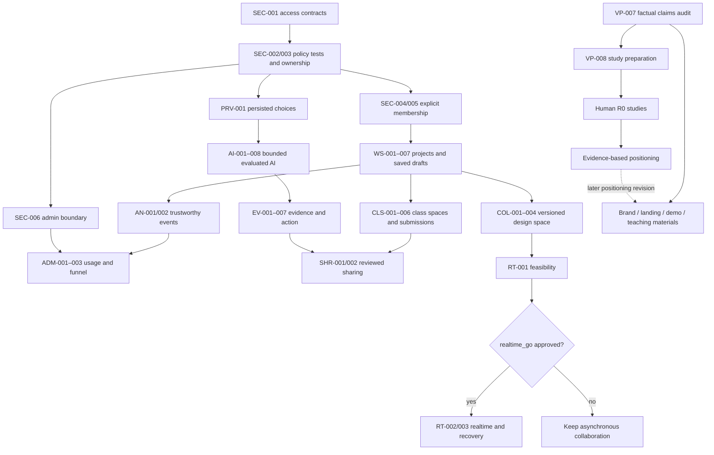

# First Ten: execution roadmap

Iteration 5 is the current plan. It expands the owner-requested product direction into small, inspectable tasks for coordinated parallel agents. The registry records the original plan and the implementation now being delivered. Public branding, the fictional demo and teaching resources have shipped; individual task evidence distinguishes the remaining work. Iterations 1–4 and every original dated Note remain in [the historical archive](FEATUREROADMAP_history.md).

Read [ProductSpec.md](ProductSpec.md) first. Related: [README](README.md) · [company values](docs/company-values.md) · [task index](docs/roadmap/task-index.md) · [canonical task registry](docs/roadmap/tasks.json) · [legacy audit](docs/roadmap/legacy-audit.md) · [OpenRouter plan](docs/roadmap/openrouter-plan.md).

## 0. How to use this plan

1. Read §1, then inspect the task: `node scripts/roadmap.mjs --task TASK-ID`. Load its `read_first` files and dependency handoffs. A future file listed there is an output of a prerequisite, not evidence that it already exists.
2. Run `node scripts/roadmap.mjs --check` and `node scripts/roadmap.mjs --ready --json`. The tool proposes a conflict-free wave of at most three workers plus one coordinator; it does not launch agents or authorize external actions.
3. The coordinator records claims **before** dispatch. Workers use separate branches/worktrees and only their named `write_scope`. Read dependencies can be shared; writes, migrations and integration points cannot. A worker may fan out read-only analysis without creating competing writers.
4. Complete subtasks and acceptance criteria, report actual checks, and hand off a small ordinary commit. The coordinator reviews, integrates serially, verifies the combined result, appends evidence/Notes, updates §1 and regenerates the index. No published history rewriting or force pushes; preserve the Lovable connection.
5. Finish at a task boundary. If interrupted, retain the claim and record exact progress/blocker; never let an expired lease silently release a live writer. Reconcile outstanding workers before starting a new wave.

**Canonical state:** `docs/roadmap/tasks.json` owns task/subtask status, dependency edges, decision gates, claims, scopes, acceptance, metrics, rollback and dated notes. This document owns strategic decisions and the session cursor. The index and legacy audit are generated views. Edit neither view by hand. No duplicate checkbox list is authoritative.

Statuses are `not_started`, `in_progress`, `blocked`, `complete`, `deferred`, `dropped`. `blocked` needs a concrete missing prerequisite and an unblock action; `deferred` needs an activation condition; `dropped` preserves the reason and replacement. A completed parent requires all subtasks complete and linked completion evidence. A research task may complete with a negative finding; that does not approve a product claim or downstream go decision. Human tasks are returned separately and never dispatched as autonomous interviews.

## 1. State

```yaml
current_iteration: 5
current_stage: P1_foundation_with_parallel_P2_and_R0
status: in_progress
last_task_done: WS-002
next_task: PRV-001
next_parallel_wave: [SEC-005, PRV-001, EXP-002]
active_claims: [PRV-001, SEC-005, EXP-002]
research_gate: not_passed
foundation_gate: not_passed
realtime_go: pending
last_updated: 2026-10-18
last_documentation_update: "2026-10-18: AI-002 complete; resumed lifecycle/admin parallel work; added FERPA-first account-free class/hackathon spaces and PDF export of every activity/team."
resume_hint: >-
  Owner resumed all roadmap work and added FERPA-first no-account class/hackathon spaces
  plus PDF of every activity/team. Registry137tasks; guest source/capability/export/retention
  contract reviewed with no remaining design contradiction, not institutional approval.
  AI002 complete: persisted origins and owner metadata; actual synthetic question save/reload
  and two-connection atomic outreach rehearsal passed. Extra call reported0.004239USD.
  WS001 and SEC006 foundations integrated with official types;794real SQL assertions and
  real lifecycle CAS race pass;437app tests/typecheck/lint/build pass. Pitch script lint fixed.
  Exact09000/10000 hosted dryrun reviewed and normal apply succeeded. No automatic admin grant.
  Archive marker is recoverable metadata; WS009 owns eventual ordinary-write freeze.
  EXP001 integrated91e5a4d: actual local PDF engine with frozen preview/select/redact;
  two/sevenpage generatedPDFs visually inspected.463combined app tests/typecheck/lint/build pass.
  AI003 offline improvements integrated43c8b2e; paid adapter still blocked on bounded budget.
  WS002 integrated0e33ea9 with455worker tests/typecheck/lint/build; deployed journey pending.
  Workers implementSEC005 invitations, PRV001 processingpermissions and EXP002 everyactivityPDF.
  f60ed4e GitHubCI passed; live presenteradmin verified after hosted migrations.
  Existing Stage2 fictional marketing plan revision7 and private teaching planner persist.
  Guest classrooms, all activity PDFs, general AI budgets, sharing/realtime remain unfinished.
```

**Audit basis:** product source and documentation at `7006f87`, plus the concurrent team-credits commit `a2d69a3`, with repository research files rechecked. F-007 is now complete: [GitHub CI run 39092157827](https://github.com/ianroy/first-10/actions/runs/39092157827) succeeded for that commit. The earlier local typecheck, 17 tests, Vercel build and scoped lint results remain in history. Six existing lint warnings and generated `.vercel` scanning motivate OPS-001. A green code pipeline does not verify live auth, RLS, model quality, research outcomes or preview configuration.

**Scope decision:** the owner's request authorizes planning the broader teaching, personal, admin, brand and collaboration product now. It supersedes Iteration 4's blanket R0-only delivery ordering. R0 research continues alongside buildable work; it still controls claims of value, buyer fit and outcomes. Engineering gates control what can safely be enabled. This comprehensive registry intentionally exceeds the old 6–12-task planning limit; dispatch waves stay small, and later regeneration should select 6–12 focused tasks.

**Still unknown:** the dominant founder blockage; voluntary return versus course compliance; reviewer and buyer needs; actual purchasing path; useful low-cost model/provider combinations; eligible privacy settings and account budgets; class pilot feasibility; and whether realtime's benefit justifies its cost. No participant interviews, outcome synthesis or measured model comparison has been invented to resolve these.

## 2. Product thesis and what we need to learn

**Working thesis, revised 2026-10-17**: a student founder with a live app and few or no recurring users may need a short path from a relevant customer conversation to a better decision and a concrete next action. First Ten already provides questions, notes, synthesis and experiments; whether that workflow solves the founder's most urgent problem is untested. Access to customers, time, confidence and skill are competing explanations, not established diagnoses.

**Evidence available now**: [the supplied title-level signal brief](research/inspiration/reddit-signals-2026-10.md) offers inspiration; [the canvas](research/value-prop.md) and [interview guides](research/interviews/README.md) are research preparation. The interview log is empty, all tallies are zero, and `research/synthesis.md` does not exist. No activation, retention, willingness-to-pay or comparative-outcome dataset is present. These absences were reconfirmed during the Iteration 5 audit following `7006f87`; they do not establish that no one uses the live app.

**Assumptions to test** (replaces the former title-frequency tests; seek recent episodes and counterexamples):

| ID  | Assumption                                                          | Supporting observation                                                                  | Observation that weakens it                                                           |
| --- | ------------------------------------------------------------------- | --------------------------------------------------------------------------------------- | ------------------------------------------------------------------------------------- |
| A1  | Finding a relevant first person is a major blockage                 | A recent attempt stalled because the founder could not reach a person with the problem  | Relevant people were available; the blockage occurred elsewhere                       |
| A2  | Polite responses hide weak demand                                   | Praise led to no action and misled a specific decision                                  | A warm contact with the problem supplied useful disagreement or acted                 |
| A3  | Help running interviews changes behavior                            | The founder uses the flow for a real conversation and explains what it enabled          | Existing notes/scripts work as well, or the actual need is access to people           |
| A4  | Referrals and communities are useful routes beyond initial contacts | A relevant trial or repeat user can be traced to that route                             | Other routes work better, or community participation yields no relevant conversations |
| A5  | Traceable evidence improves a founder's next decision               | The founder uses an observation and its limitations to change or retain a specific plan | A summary adds no decision value beyond their current workflow                        |
| A6  | A guided next step helps more than it constrains                    | The founder takes a useful action without chasing completion counts                     | Gates delay learning, encourage box-ticking, or mismatch the founder's situation      |

### 2.1 Value proposition: from conversations to decisions (candidate, not validated)

**Beachhead to test**: a student founder with a live prototype/app, few or no recurring users, and a recent attempt to find users. Include course and self-directed founders, but analyze them separately. This is a recruiting focus, not a finding that students are the best market. Idea-stage entrepreneurs and experienced sales teams are outside this first sample.

**Trigger and job**: "I launched, got little useful response, and don't know whether to change the product, change who I'm approaching, or keep trying. Help me take a real step and learn enough to choose the next one."

**Candidate promise**: _Turn real customer conversations into a clearer next move: who to focus on, what to change, and what to try next._

The longer-term aspiration is first users who return. The immediate value to test is a decision the founder can explain and act on. Narrowing an audience, keeping a feature for a stated reason, abandoning a weak assumption, or stopping an idea can all be useful outcomes. A confident founder with no supporting observations is not the target outcome.

**The smallest value loop** (test manually alongside the requested implementation):

1. Choose a reachable person who has experienced the relevant problem; record why they fit. A friend can qualify, but friendship alone is not fit.
2. Ask about the last occurrence, consequences and workaround; capture what happened, including disagreement and missing information.
3. Separate observation, interpretation and uncertainty. Record any requested action and whether it actually happened.
4. Choose one next decision and action: focus the audience, change something, recruit another person, test a behavior, or stop.
5. Return to the observation and check what happened after the action. The repeated loop, rather than a polished AI summary, is the candidate product advantage.

**First useful result**: "I can name whom I'm learning from, point to something they did or described, explain what remains uncertain, and choose my next move." The current app supports pieces of this loop, but does not yet guarantee claim-level evidence links or record every follow-through step.

**What “proof, not praise” gets right—and where it overreaches**: keep the distinction between opinions and actions; replace promises of proof with evidence and its limits. Ten interviews are not proof of demand. An intro, a promised meeting, a completed trial, repeat use and payment answer different questions; they must not collapse into a universal validation score. A refused request can be informative. Consent checkboxes, timestamps and quotes are self-reported records, not independent verification that an interview happened. The 10/50/100 ladder is a learning scaffold, not an acquisition guarantee or a universal readiness threshold.

| Role                                                   | Candidate value                                                                                                   | What must be demonstrated                                                                                                         |
| ------------------------------------------------------ | ----------------------------------------------------------------------------------------------------------------- | --------------------------------------------------------------------------------------------------------------------------------- |
| Founder, primary user for this test                    | Less wasted building and outreach; a relevant conversation, an evidence-informed choice, a manageable next action | They act, explain a decision using observations, and voluntarily return; compare with their actual previous workflow              |
| Instructor/program lead, possible reviewer or champion | See reasoning, progress and where feedback would help                                                             | A recent review problem, a real artifact they can use, and a concrete follow-up                                                   |
| Budget owner, not assumed to be the instructor         | A result worth funding within an actual purchasing process                                                        | Prior spending or an identified approval path and a concrete pilot step; compliments or fake-door clicks do not establish a buyer |

**Differentiation to test**: a compact, continuous workflow across reaching out, interviewing, deciding and following through. The relevant alternative may be a combination of AI chat, a document, an LMS and a mentor. Do not claim that other AI tools lack memory, that templates cannot support synthesis, or that this is an uncontested niche. The inherited alternatives scan contains secondary sources and absolute claims; VP-007 must verify any claim retained using current primary sources. No competitor prices or capabilities are newly asserted by this regeneration.

**Value hypotheses and decision rules** (all unresolved; supersedes the earlier confirm/kill rules in the canvas until VP-008 updates it):

| ID  | Hypothesis            | Evidence to seek / reason to revise                                                                                                                                                                                                                     |
| --- | --------------------- | ------------------------------------------------------------------------------------------------------------------------------------------------------------------------------------------------------------------------------------------------------- |
| VP1 | Evidence to show      | Sharing is valuable when a founder describes an actual review and uses a small artifact in one. No sharing need weakens the reporting proposition, not private decision value.                                                                          |
| VP2 | Getting started       | Identify the last stalled attempt without suggesting fear. Build confidence coaching only if confidence repeatedly blocks action; access/time/method may imply a different solution.                                                                    |
| VP3 | Instructor pull       | Separate review pain, champion interest and buying authority. Seek past purchases, an approval path and a concrete follow-up; “would budget” is not purchase evidence.                                                                                  |
| VP4 | Follow-through        | Compare course/self-directed contexts descriptively, including facilitator help. A tiny sample cannot establish that deadlines cause retention.                                                                                                         |
| VP5 | Meaningful actions    | Record relevance, requested versus completed action, cost to the participant and follow-through. A hypothetical commitment or helping a friend is not demonstrated product demand.                                                                      |
| VP6 | Inspectable reasoning | Test whether reviewers need sources, limitations and decision changes. Do not promise authenticity verification; requests for that capability expose a gap, not confirmation of present value.                                                          |
| VP7 | Decision value (new)  | After relevant conversations, founders take an external action and make, sharpen or retain a specific decision with supporting/counterevidence; they return to use the loop. If only reporting or heavy facilitation has value, revise the proposition. |

**Messages to compare after neutral problem interviews** (VP-004a; public factual copy can proceed in WEB-001/004):

- A — current: "You built it. Now meet the people it's for."
- B — decision: "Turn real customer conversations into a clearer next move."
- C — action: "Start with one useful conversation. Decide what to try next."
- Reviewer concept — "See what teams heard, what changed, and where they need help." Test separately from founder messaging; label missing capabilities as concepts.

**Measures of delivered value** (candidate definitions, manually collected in the pilot):

| Measure                            | Definition and limit                                                                                                                                                                                                                                                                                                                                        |
| ---------------------------------- | ----------------------------------------------------------------------------------------------------------------------------------------------------------------------------------------------------------------------------------------------------------------------------------------------------------------------------------------------------------- |
| Activation                         | First completed conversation with a person relevant to the stated problem within 7 days of pilot onboarding; record actual signup age separately                                                                                                                                                                                                            |
| Useful loop, primary pilot outcome | Within 14 days, a founder completes an external action (conversation, customer request, trial or follow-up) and records a specific decision linked to observations, counterevidence/unknowns, and a next step. Retaining a decision includes what supports it and what would change it. Report n/N, dropouts and assistance; not a validated north star yet |
| Repeat value                       | A voluntary return or second loop within the window; distinguish course requirements, researcher reminders and self-initiated use                                                                                                                                                                                                                           |
| Behavioral follow-through          | Requested/completed trial, intro, repeat use or payment, reported separately with dates and source; self-reports are labeled                                                                                                                                                                                                                                |
| Reviewer value                     | A reviewer uses the de-identified artifact for a concrete feedback decision; record effort and what their existing workflow already does                                                                                                                                                                                                                    |

Clicks, generated drafts, compliments, interview volume and acceptance of an AI summary are diagnostic counts, not sufficient evidence of value. Do not require a positive commitment to count a useful disconfirming decision.

---

## 3. Values, access boundaries and AI policy

The [values charter](docs/company-values.md) defines seven commitments: **learn honestly; keep people in charge; respect participants; make the next step useful; make participation accessible; carry learning forward; use resources responsibly.** BR-001/002/003 translate them into colors, typography, interaction states and a calm, clear voice. Values are operating commitments; they are not a claim that current code already satisfies every safeguard.

SEC-001 must define a field-level permission matrix and typed service contracts before role migrations. These are the target boundaries:

| Surface              | Intended authority and visible information                                                     | Required tasks                   |
| -------------------- | ---------------------------------------------------------------------------------------------- | -------------------------------- |
| Personal workspace   | Account owner selects a project and resumes private drafts; separate ideas have separate state | WS-001–007                       |
| Project design space | Explicit owner/editor/viewer grants cover shared design content and approved excerpts          | SEC-004/005, COL-001–004         |
| Student class space  | Enrollment, assignments, a chosen project association and reviewed submissions                 | CLS-001/002/005                  |
| Teacher panel        | The teacher's classes, permitted progress metadata and intentionally submitted work            | CLS-003/004/006                  |
| Admin panel          | Operational aggregates, product funnel, AI usage/cost and freshness; no default raw notes      | SEC-006, AN-001/002, ADM-001–003 |
| Share view           | A reviewed snapshot under explicit named-recipient or expiring/revocable link grants           | SHR-001/002                      |

Being a teacher, admin or collaborator never automatically grants access to private interviews or every project table. Server/API and database enforcement must agree. Preserve immutable owner/author identity, prevent cross-project references, avoid recursive RLS helpers, narrowly grant privileged functions and fix their search path. The current first-project/owner-only conventions remain true until their explicit migration tasks update the code, spec and AGENTS together.

All AI remains behind `generateAI` in `src/lib/ai.functions.ts`. [The OpenRouter plan](docs/roadmap/openrouter-plan.md) provides dated official sources, cheap candidates, cost arithmetic, endpoint eligibility checks and per-kind opportunities. AI-001–008 build runtime validation, prompt versions, evaluations, atomic cost reservations, bounded routing and authorized source context. Only then do new kinds add question/outreach help, evidence challenge, lesson/feedback drafts, aggregate explanations and design suggestions. Permissions, counters, stage gates and financial accounting stay deterministic.

Use the cheapest **eligible, evaluated** route for each job. The proposed shortlist includes Gemini Flash Lite variants and GPT-5 Mini; the existing Sonnet configuration is a comparison baseline. Model price is not evidence of output quality or provider eligibility. Capture actual cost, cap concurrent spend before calls, reconcile unknown outcomes and preserve previous drafts on failure. No paid comparison was run during this planning pass. Before any paid execution, use a configured operator-owned budget and test key; a proposed number in a document is not a purchase or a new account-limit authorization.

## 4. Phases and order of operations

Phases describe delivery order; exact dependency edges in the registry determine readiness. Independent tracks can overlap. Do not wait for every task in an earlier phase when the specific dependencies are complete, and do not skip a named gate because a phase label looks ready.

| Phase        | Outcome                                         | Main work                                                                                          | Exit evidence                                                                            |
| ------------ | ----------------------------------------------- | -------------------------------------------------------------------------------------------------- | ---------------------------------------------------------------------------------------- |
| P0           | A safe execution baseline and agreed contracts  | OPS-001, SEC-001; values/planning already authored                                                 | Repeatable checks; permission/API contract                                               |
| P1           | Reliable data, privacy and economical AI        | OPS, SEC, PRV, AI foundation tasks                                                                 | Real RLS tests, metering/concurrency tests, bounded model eval, preview/restore evidence |
| P2           | A credible public and educator entry point      | Brand, sales pitch, fictional interactive demo, stack schematics, teaching page and lessons        | WEB-005 with factual claims and working accessible journeys                              |
| P3           | Durable personal work across ideas and sessions | Project lifecycle, explicit routing/caches, personal panel, versioned drafts and atomic completion | WS-007: no lost acknowledged saves or cross-project state                                |
| P4           | Separate teacher and admin workflows            | Event contract, funnel dashboard, classes, reviewed submissions, feedback and lesson AI            | Scoped services and complete role-specific flows                                         |
| P5           | A stronger evidence-to-action loop              | Preserved generations, decisions/experiments, commitments, challenge, coach and first ask          | Source-backed drafts, manual alternatives and per-kind checks                            |
| P6           | Controlled sharing and collaboration            | Redacted snapshots, recipient grants, versioned design editing/comments, optional realtime         | Revocation/conflict tests; separate RT go/no-go and live gate                            |
| P7           | Integrated, observable release and learning     | Cross-role QA, accessibility, staging/restore, release, real class/usage studies                   | REL-001–005 and observed findings with limitations                                       |
| R0, parallel | Better understanding of founder/reviewer value  | Claims audit, guides, human interviews, manual prototype, 14-day pilot and synthesis               | G-004 records proceed/narrow/pivot/hold/stop with source evidence                        |
| HOLD         | Explicitly deferred options                     | Voice, PWA, community finder, surveys, model picker, digest, peer panels, deck                     | Evidence/activation conditions met and coordinator reschedules                           |

The [task index](docs/roadmap/task-index.md) lists every task's status, owner, size, dependencies, decision gates and write scope. Inspect a task for its detailed steps, individually tracked subtasks, acceptance, verification, metric, rollback and agent notes.

A useful dependency overview (the registry contains the full graph):



The public materials may use factual provisional copy before the research positioning decision; WEB-001 needs the claims audit, not an invented positive research result. RT-002/003 require `realtime_go: approved`; a no-go is a valid completed spike and moves those tasks to deferred. Realtime is not required for the core beta. Conditional features stay disabled until their own gates pass.

### First dispatch and subsequent opportunities

The initial proposed wave is **OPS-001 + SEC-001 + VP-007**: verification configuration, access/API documentation, and research claims live in separate write scopes. **BR-001** and **WEB-003** can use subsequent free slots. Once the first wave lands, the coordinator can fan out policy-test setup, existing AI hardening, interview-protocol preparation or brand tokens as dependencies permit. Re-run readiness each time; the tool's current output overrides this illustrative order.

The critical path to class collaboration is ownership → membership → explicit project identity → saved work → class association/submission permissions → scoped teacher/shared services. AI foundation work can overlap brand/lesson work. Public demos use fictional local fixtures and incur no provider calls. EDU-004 offers an early instructor rehearsal of the lesson materials after EDU-001; the full EDU-003 class pilot waits for the role/security gate. Database migrations, the AI gateway and route integration are serialized even when their tasks otherwise appear independent.

## 5. Parallel execution contract and completion rules

**One coordinator owns** the registry, this state block, append-only notes, generated roadmap views, integration branch, migration numbering, generated database types, generated route tree, dependency lockfiles and final release actions. Workers edit only assigned source scopes. If a generated file or shared manifest must change, include the requested change in the handoff and let the integration owner regenerate it once. The coordinator may temporarily delegate a single serialized integration task explicitly.

A claim is an object on the task, paired with `status: in_progress`:

```json
{
  "owner": "worker-identifier",
  "branch": "codex/TASK-ID-short-name",
  "base_commit": "full commit sha",
  "worktree": "/absolute/isolated/checkout",
  "started_at": "ISO-8601 timestamp",
  "lease_expires_at": "ISO-8601 timestamp"
}
```

The example is a format, not an active claim. Record real values and an agreed lease. `--ready` checks active claims, overlapping write scopes and exclusive locks; it holds stale leases for reconciliation. The coordinator must check workers are stopped and reconcile changes before clearing a claim. Claim recording and dispatch happen serially from a single coordinator; the CLI is an advisory validator, not a distributed lock service. Do not run parallel git mutations in the same checkout.

Task notes include a concrete starting point and stop/handoff instructions. For a less experienced worker:

1. Confirm the current base, dependency artifacts and intended behavior. If an API is missing, return to its dependency owner; do not invent a second incompatible contract.
2. Perform the numbered subtasks in order. Preserve current data and working behavior until the replacement passes. If the work no longer fits a reviewable task, request a coordinator split before broadening scope.
3. Add checks that exercise a meaningful failure or permission boundary. A database mock is insufficient for RLS. New AI kinds need schema, source/permission, cost and task-quality evaluation; fluent sample output is insufficient.
4. Report each check as passed, failed, not run or blocked, with exact commands/environment and evidence. Never call a task complete from file existence, elapsed time, a plan or a mocked happy path.
5. Hand off changed files, base/result commit, subtask results, acceptance evidence, migration/type/API changes, observed costs, remaining risks and rollback. The coordinator reviews the actual diff and updates canonical status after integration checks.

Verification profiles:

| Profile        | Required verification                                                                                                                                                |
| -------------- | -------------------------------------------------------------------------------------------------------------------------------------------------------------------- |
| Planning/docs  | Source/claim/date audit, local links, readable diagrams/resources, registry validation, generated-view drift check; no invented product test results                 |
| Product        | Existing lint/typecheck/test/build plus focused behavior tests; `NITRO_PRESET=vercel` for build; real policy tests for data/access; multi-client tests for conflicts |
| AI             | Product checks plus versioned held-out cases, runtime shape/source validation, bounded actual eligible-endpoint eval, usage accounting and negative/failure cases    |
| Human research | Real consented notes/artifacts, context and denominators, assistance/withdrawals, contrary evidence; no synthetic testimony or autonomous recruiting                 |
| Release        | Actual isolated preview/staging evidence, migration/restore rehearsal, operational caps, documented enabled flags and production smoke                               |

Current commands: `npm run typecheck`, `npm run test`, `npm run lint -- --ignore-pattern '.vercel/**'`, `NITRO_PRESET=vercel npm run build`. OPS-001 normalizes the lint exclusion and CI wiring; until it lands, do not report plain lint as fixed. Future policy/eval commands must be delivered by their prerequisites. Use Node 22.12+ and the repository's Bun 1.3.5 lock workflow.

An agent may prepare study materials and process supplied notes, but human-owned recruiting/interviews remain human work. This plan does not send outreach, schedule unattended runs, purchase services or expose private data. Deployment/integration follows the user's authorized scope and the concrete task; do not infer a later production rollout authorization solely from a future release task existing in a roadmap.

## 6. Regeneration prompt

Use this after a completed wave, a material scope/evidence change, or an explicit owner request:

> Read ProductSpec.md, this roadmap §0–1 and the canonical registry. Audit the current code, Git/CI evidence, task notes and real research artifacts; do not assume old checked boxes or written plans are implemented. Reconcile every active/incomplete/deferred task and subtask. Preserve completed evidence and all dated Notes; map each split, replacement or drop in the legacy audit rather than deleting history.
>
> Distinguish shipped capability, authorized planned scope, hypotheses, observed user outcomes and missing evidence. Reassess founder value, teacher/reviewer needs, buyer path, company values and the least expensive useful AI intervention. Use primary sources for changing provider/model claims. Keep one server AI gateway, validated schemas, permission-scoped context, budget enforcement and human review.
>
> Select a focused 6–12-task follow-up unless the owner explicitly requests a comprehensive redesign. Give every task and subtask a status, owner, dependencies, decision gates, source files, bounded write scope/locks, ordered implementation notes, observable acceptance, verification, useful metric and rollback. Move unknowns into explicit research/spike tasks; human-dependent tasks cannot be completed by invented observations. Separate an engineering release decision from a market-value claim.
>
> Recompute the DAG and phases, identify the actual critical path, and propose up to three nonconflicting ready tasks. Serialize migrations, generated types, route integration, shared manifests and AI entry-point changes. Preserve archived tasks and the no-history-rewrite rule. Run registry validation, scheduler tests and generated-view checks. Append the decisions/iteration log and update §1 before stopping. Do not start future feature implementation merely because regeneration produced the plan.

## 7. Execution prompt

> Read ProductSpec.md then FEATUREROADMAP_workplan.md §0–1. Run `node scripts/roadmap.mjs --check` and `--ready --json`; inspect assigned task briefs with `--task ID`. Confirm task dependencies are complete, its required decisions approved, and its scope is authorized for this session. The coordinator claims up to three independent tasks with separate branches/worktrees and assigns shared-file integration ownership. Workers perform only the assigned task/subtasks and report evidence; they do not update canonical status or publish independently.
>
> Implement the smallest complete behavior that satisfies the task. Preserve private evidence, scope every operation to an authorized account/project/class/document, use the shared AI gateway with validated bounded model policy, and keep manual recovery paths. Stop only the blocked task when a required artifact, budget, environment or human observation is absent; explain the exact missing prerequisite and continue another eligible task. Do not fabricate research, silently promote a model, loosen access controls or expand a worker's write scope.
>
> Run the task's meaningful verification and return its handoff. The coordinator integrates serially, runs combined checks, appends evidence and notes, reconciles claims, regenerates the index/audit, and updates §1/§9. Ordinary commit/push only within the user's authorization; never force-push or rewrite published history. If there is no runnable work, report the actual blockers and human decisions needed. Do not recursively start the whole registry without a bounded dispatch instruction.

## 8. Decision log (append only)

| Date       | Decision                                                                                                                                                                | Why                                                                                                                                                                                 | Alternatives rejected                                                                                                      |
| ---------- | ----------------------------------------------------------------------------------------------------------------------------------------------------------------------- | ----------------------------------------------------------------------------------------------------------------------------------------------------------------------------------- | -------------------------------------------------------------------------------------------------------------------------- |
| 2026-10-17 | Host on Vercel with Nitro `vercel` preset                                                                                                                               | Owner uses Vercel; Lovable hosting not needed                                                                                                                                       | Cloudflare (wrapper default)                                                                                               |
| 2026-10-17 | New Supabase project `first-10` (hdwnnuvqqkkpontcdbwa)                                                                                                                  | Isolation from other projects                                                                                                                                                       | Reusing existing projects                                                                                                  |
| 2026-10-17 | LLM via OpenRouter, default `anthropic/claude-sonnet-4.5`, strict JSON schema, non-streaming                                                                            | Model flexibility and one key; JSON outputs are small                                                                                                                               | Lovable AI gateway (only works inside Lovable)                                                                             |
| 2026-10-17 | Research before features, but Reddit audit cancelled; use supplied signal brief as inspiration plus founder interviews                                                  | Reddit unreachable to tools; owner chose the brief                                                                                                                                  | Reddit API app, pasted URLs, Claude in Chrome (blocked)                                                                    |
| 2026-10-17 | First R2 slice = Proof Not Praise, Devil's Advocate, Interview Coach; Community Finder held                                                                             | Highest signal-to-effort, least dependent on unresolved privacy work and interviews                                                                                                 | Community Finder first; Pain Miner                                                                                         |
| 2026-10-17 | Iteration 3 supersedes Iteration 2's ordering; value-prop track front-loaded                                                                                            | Owner asked to understand and deepen the value prop before building more; nothing in Iteration 2 had started                                                                        | Running Iteration 2 as planned                                                                                             |
| 2026-10-17 | Working value prop: "proof, not praise", with two segments (student founder user, instructor/program buyer) as hypotheses VP1-VP5; final positioning deferred to VP-006 | The signal brief points to validation confusion and flattering AI; proof has an audience                                                                                            | Keep the process-led "ladder" message only                                                                                 |
| 2026-10-17 | Evidence Pack and first-ask kickstart promoted, conditional on VP1/VP3 and VP2; instructor view tested as a fake door first                                             | Deepen the value before widening features; don't build a cohort view before instructor pull is shown                                                                                | Build the cohort dashboard now                                                                                             |
| 2026-10-17 | Final task of the iteration: 5-minute pitch deck and architecture diagrams (P-001), evidence-only numbers                                                               | Owner request; the deck should tell the deepened story with real data                                                                                                               | A deck now from assumptions                                                                                                |
| 2026-10-17 | Iteration 4 replaces the unfinished multi-stage delivery queue with 11 R0 tasks; R1/R2/R3 deferred and gates remain open                                                | No interview notes, synthesis or usage findings exist; owner again requested deeper value understanding. Preserve partial F-007 and all deferred work                               | More features before observing value; treating old plans as shipped                                                        |
| 2026-10-17 | Test the promise “real conversations → clearer next decision → action”; add VP7 and narrow VP6 to inspectable reasoning                                                 | Current workflow can support a small test; counts, commitments and self-reported records do not prove demand or interview authenticity                                              | “Proof” as certainty; universal commitment scores; assuming all stalls are fear                                            |
| 2026-10-17 | Founder value is the primary test; instructor/reviewer/budget roles investigated in parallel                                                                            | No buyer evidence yet; useful decisions and a purchasing path are distinct questions                                                                                                | Assuming a program is the buyer because students have free alternatives                                                    |
| 2026-10-17 | Manual comprehension and artifact tests plus a three-founder 14-day pilot precede new telemetry, sharing or gates                                                       | Small purposive research can reveal mechanism and friction without requiring unbuilt features or traffic                                                                            | Premature A/B conversion claims, a fake door as payment evidence, synthetic participants                                   |
| 2026-10-17 | Preserve prior research as hypotheses; re-audit inherited alternative claims with primary sources in VP-007                                                             | Existing scan contains secondary sources and unsupported absolutes; no new external verification performed in this regeneration                                                     | Repeating competitor prices or “no competitor” claims as established facts                                                 |
| 2026-10-17 | Iteration 5 supersedes the R0-only execution queue and schedules the owner-requested broader product                                                                    | Owner explicitly requested teaching/admin/personal/collaboration, brand and low-cost AI tasks ready for parallel agents                                                             | Blocking all engineering until interviews; treating broader scope as evidence of demand                                    |
| 2026-10-17 | Canonical task registry, tracked subtasks, isolated workers and serialized integration                                                                                  | Dependencies and shared files must be machine-checkable; every legacy task/seed is mapped and original Notes archived                                                               | Parallel writers updating one roadmap or migrating the same schema independently                                           |
| 2026-10-17 | Define seven company values and separate personal, class, admin and shared-content permissions                                                                          | Product trust and pedagogy require intentional visibility and accurate claims                                                                                                       | A teacher/admin role automatically reading private interviews; universal proof or authenticity scores                      |
| 2026-10-17 | Economical per-kind OpenRouter policy follows eligibility, budgets and actual evaluations                                                                               | Listed token price alone does not establish quality, data policy or total cost                                                                                                      | An expensive automatic fallback or client-selected arbitrary model                                                         |
| 2026-10-17 | Deliver versioned asynchronous collaboration before conditional realtime                                                                                                | Durable saving, conflict handling and live revocation need independent proof                                                                                                        | Presence mistaken for saved state or simultaneous editing that loses updates                                               |
| 2026-10-17 | F-007 complete from verified CI; split production connection from missing preview scope                                                                                 | CI run 39092157827 is green for 7006f87; no new preview or model test was performed                                                                                                 | Keeping verified CI pending or marking all of F-009 complete                                                               |
| 2026-10-18 | Record the final-sprint owner-private subset as WS-008, EDU-005 and DEMO-003; complete DEMO-002 only for verified presenter aggregate access.                           | Existing broader lifecycle, class membership, student visibility and platform-admin gates remain open. Four authored team examples and 45 planned capacity are not live enrollment. | Treating a seeded presenter experience as a shipped shared classroom or measured learning outcome.                         |
| 2026-10-18 | Canonical AI-009 tracks the requested AI-DEMO-001 fixed fictional practice route with a $1 workshop reservation cap within the $25 overall authorization.               | One bounded Vertex ZDR request is allowed only after exact presenter authorization and atomic reservation; deployed provider verification is still pending.                         | Promoting the general model baseline from offline fixtures or silently broadening routing when the restricted route fails. |

## 9. Iteration log (append only)

| Date       | Entry                                                                                                                                                                                                                                                                                                                                                                                                                                                  |
| ---------- | ------------------------------------------------------------------------------------------------------------------------------------------------------------------------------------------------------------------------------------------------------------------------------------------------------------------------------------------------------------------------------------------------------------------------------------------------------ |
| 2026-10-17 | Reddit audit cancelled; signal brief adopted (R0-001/002 done, backlog FB-15..18 added)                                                                                                                                                                                                                                                                                                                                                                |
| 2026-10-17 | Initial roadmap written: Iteration 1 (R0 research plus R1 foundations). Nothing executed yet.                                                                                                                                                                                                                                                                                                                                                          |
| 2026-10-17 | Regeneration run: Iteration 2 planned (carry-over R1, R0 gate, I2-001..005, X-001, L-002, G-002). Reconciled F-002 (partial), F-009, F-010 done. Collapsed nothing: Iteration 1 is not finished.                                                                                                                                                                                                                                                       |
| 2026-10-17 | Regeneration run (value-prop focus): Iteration 3 planned. Added §2.1 value proposition (two segments, VP1-VP5, one-liners, metrics), VP-001..VP-006, I3-001/I3-002 (conditional), G-003, P-001 final (pitch deck and architecture diagrams). Dropped R0-003 and G-002. Iteration 2 marked superseded; its task definitions kept.                                                                                                                       |
| 2026-10-17 | VP-001 and VP-002 done: value-prop canvas with sourced alternatives, new hypothesis VP6 (proof it was real), founder and instructor interview guides with tally. Next: owner interviews (R0-004, VP-003); agent R1 carry-over from F-007.                                                                                                                                                                                                              |
| 2026-10-17 | Paused by owner mid F-007 (tests, stage-logic extraction and CI committed; final local re-check of typecheck/lint/tests pending).                                                                                                                                                                                                                                                                                                                      |
| 2026-10-17 | Regeneration run: Iteration 4, 11 R0 tasks, next VP-007. Revised promise toward evidence-informed decisions; added VP7; explicit numeric re-rank with all evidence scores at 1. Split founder interviews, message testing and positioning; deferred R1/features/deck, replaced G-003 with G-004. Empty interview log and missing synthesis remain explicit; F-007 is still partial and no code/tests/deployments were run. Only this roadmap changed.  |
| 2026-10-17 | DOC-001: deepened README/ProductSpec with candidate value and verified product/technical boundaries; updated setup and operational guidance. Local typecheck, 17 tests, Vercel build and lint excluding generated output passed (6 existing warnings). Next stays VP-007; F-007 awaits GitHub CI confirmation and no research gate was passed. Owner requested commit/push of this documentation and the preceding roadmap commit.                     |
| 2026-10-17 | PLAN-001: completed Iteration 5 execution-readiness audit, company values, researched OpenRouter policy and canonical registry. 110 tasks / 306 tracked subtasks; all 47 historical task IDs and 19 backlog ideas reconciled. Added scheduler/validator tests, phase gates, claims and collision rules. Product features remain not started; first proposed wave OPS-001 + SEC-001 + VP-007. Validation evidence is recorded with the planning commit. |
| 2026-10-17 | Reconciled concurrent DOC-002 commit a2d69a3: preserved all team credits and the documentation-update state note; added its completed task to the registry and historical audit.                                                                                                                                                                                                                                                                       |

| 2026-10-18 | Autonomous run activated with owner authorization to commit/push often and deploy; $25 total OpenRouter cap, no other paid services. Tomorrow’s Babson workshop/mini hackathon is the primary delivery context. First parallel wave claimed. |

| 2026-10-18 | Owner promoted a core Next 50 $0 marketing lab inspired by BUS131 slides/board: audience, physical/digital channels, AI content, measurable one-week test and reflection. Added MKT-001–008, fictional presenter-data seeding and original logo/favicon work. Pitch deck promoted for tomorrow with explicit pedagogy and truthful current/proposed claims. |

**2026-10-18 — final-sprint reconciliation at f8bc878:** DEMO-002 completed for verified production count-only presenter access; WS-008, EDU-005 and DEMO-003 recorded complete for shipped narrow features. Coordinator reports 219 app tests, 391 real isolated SQL assertions, typecheck/lint/build green and Vercel READY. Hosted private teacher plan seeded through owner RPC at revision 1; actual local desktop shows four authored teams and 45 planned capacity, not enrollment. AI-009 remains in progress for the deployed provider trial, with no live-model success claimed. Shared-class, broad admin, research and realtime gates remain unchanged.
