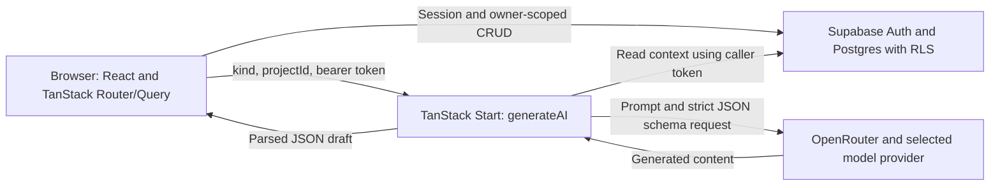

# First Ten: Product Spec and Developer Onboarding

First Ten helps a student founder turn early customer conversations into a clearer next move. This document explains the intended value, the behavior implemented in this repository, and the constraints that contributors must preserve.

Read this first, then [the roadmap's state and current iteration](FEATUREROADMAP_workplan.md). The [README](README.md) is the shorter introduction and setup guide. The roadmap decides what to investigate or build next; this spec does not authorize its candidate features.

**Documentation basis, 2026-10-18:** the current repository now includes the original brand/favicon, public StudyLoop demo, teaching page and printable kit, deployment smoke, runtime-validated AI gateway and deployed relational ownership protections. The active autonomous run and task registry record exact verification. No completed participant study, learning-effect result or validated demand is claimed. The current integration also includes email/password and email-link entry, desktop workspace navigation, owner-only multiple ideas and project switching through Account & saved work, a narrowly authorized aggregate admin dashboard, the saved manual Marketing Lab and an owner-private instructor planner. General marketing AI, teacher/class access roles, broader platform administration and controlled collaboration remain unfinished. Restricted fixed-case presenter AI practice is implemented in the current integration source, with live-provider verification pending. Implementation descriptions are based on inspected source; deployment and browser evidence must be checked for the exact revision.

## 1. Product in one paragraph

First Ten is a responsive customer-discovery app for student founders with a live prototype or app and few or no recurring users. It provides editable interview questions, consent-led note taking, synthesis, experiments and outreach drafts across a three-stage ladder: **First 10**, **Next 50**, **Next 100**. The founder chooses whom to approach, has the conversations, reviews the drafts and decides what to do. The candidate promise is: **turn real customer conversations into a clearer next move—who to focus on, what to change, and what to try next.** Finding users who return is the longer-term aspiration; conversation counts and an accepted AI summary do not establish demand.

### 1.1 The user, trigger and job

The initial research focus is a student founder who has built something, recently tried to recruit users, and is unsure whether to change the product, change the audience or keep trying. Course and self-directed founders may need different kinds of support; do not combine their outcomes without recording that context.

| Role                                                   | Value to investigate                                                                                          | What remains unknown                                                                                                                                          |
| ------------------------------------------------------ | ------------------------------------------------------------------------------------------------------------- | ------------------------------------------------------------------------------------------------------------------------------------------------------------- |
| Founder, primary user                                  | Take a manageable external action, learn from a relevant person, and choose the next step with less guesswork | Whether access, time, skill, confidence or decision-making is the main blocker; whether the workflow earns repeated use                                       |
| Instructor or program lead, possible reviewer/champion | Understand what a team heard, what changed and where feedback would help                                      | Whether reviewing this evidence improves their existing process; public resources and private lesson planning exist; no student/class review workspace exists |
| Budget owner                                           | Fund an outcome that matters to a course or program                                                           | Who approves and pays, how purchasing works, and whether any purchase is justified                                                                            |

The functional job is choosing a useful next action. The possible emotional benefit is less uncertainty about reaching out or changing direction. The possible social benefit is explaining one's reasoning to teammates or reviewers. These benefits need observation, not just agreement with a pitch.

The working differentiation is continuity from conversation to follow-through. Compare it with a founder's actual combination of AI chat, documents, spreadsheets, course assignments and mentoring. Do not assume those alternatives lack memory, structure or analysis, or claim an uncontested market. [VP-007](FEATUREROADMAP_workplan.md) audits the inherited alternatives scan before those claims are reused.

### 1.2 The value loop and its current support

| Step                      | Intended useful outcome                                 | Implemented support                                            | Remaining gap                                                                                                 |
| ------------------------- | ------------------------------------------------------- | -------------------------------------------------------------- | ------------------------------------------------------------------------------------------------------------- |
| Choose a relevant person  | Know why this person has experience of the problem      | Contact first name, relationship and reason to ask             | No verified prospect discovery or audience-fit check                                                          |
| Ask about recent behavior | Understand a concrete situation and workaround          | Editable questions; one-question-per-screen interview session  | No question-quality checker or live coaching                                                                  |
| Preserve observations     | Keep notes, exact words and uncertainty distinguishable | Question/note/quote answers and tags                           | No claim-level evidence links, persisted consent record or interview authenticity verification                |
| Make a decision           | Explain what to change, retain, test or stop            | Editable synthesis, suggested changes and experiment fields    | Marketing Lab has manual repeat/revise/stop reflection; no general source-linked decision or confidence model |
| Follow through            | See what happened after the next action                 | Experiment results, manual contact pipeline and Stage 3 counts | No automatic usage tracking, follow-up reminders or repeated-loop measurement                                 |

A useful result might be: “These two people described the same costly workaround; I will focus on their situation and test one change.” A useful result can also be: “The people I approached do not have this problem; I will change the audience or stop.” The app should not force a positive conclusion or a commitment just to count progress.

### 1.3 Product principles

Changes to these principles require a decision in the roadmap.

1. **AI drafts, the founder decides.** Questions, summaries and outreach are reviewable drafts. The app does not send outreach, publish posts or contact interviewees. Sending data to the AI provider is a separate operation described in §5.
2. **Ask about past behavior.** Interview guidance asks what happened, what people tried and what it cost. Avoid pitching and hypothetical willingness questions. The existing `would use` and `would pay` tags are a legacy mismatch; treat them as reported statements, not observed use or payment.
3. **Fit matters more than familiarity.** A friend can be a relevant participant; knowing the founder is not evidence of having the problem. Record the reason for speaking to them.
4. **Respect the participant.** Use first names or roles and obtain permission before taking notes. Do not enter sensitive personal information. Note-taking consent does not by itself establish permission for external AI processing or sharing quotes.
5. **Keep the next action small.** Use plain language, mobile layouts and a clear next step. Add complexity only when it helps a real decision.
6. **Evidence includes disagreement.** Preserve observations, interpretations and limits. Introductions, trials, repeat use and payments answer different questions; there is no implemented universal validation score.
7. **Make uncertainty visible.** The ladder is a scaffold, not proof of demand, guaranteed customer acquisition or certification that interviews happened.
8. **Carry reviewed learning forward.** Later stages build on the previous stage’s accepted learnings alongside the underlying interviews. Preserve that continuity when adding growth features; do not replace reviewed evidence with generic advice.

### 1.4 How value will be assessed

The R0 track tests the workflow with interviews, manual concepts and a three-founder pilot while the owner-requested Iteration 5 engineering plan proceeds through its own gates. These are proposed research measures, not metrics already instrumented in the app:

| Measure        | Proposed definition                                                                                                        |
| -------------- | -------------------------------------------------------------------------------------------------------------------------- |
| Activation     | First conversation with a relevant person within 7 days of pilot onboarding; distinguish onboarding from account signup    |
| Useful loop    | Within 14 days, an external action plus a specific decision tied to observations, counterevidence/unknowns and a next step |
| Repeat value   | A voluntary return or second loop, separated from course requirements and researcher prompting                             |
| Follow-through | Requested, agreed and completed actions recorded separately; distinguish trial, intro, repeat use and payment              |
| Reviewer value | A reviewer uses a de-identified record to make a concrete feedback decision                                                |

Record denominators, withdrawals and assistance. A facilitated paper exercise can demonstrate interest in a workflow without demonstrating that the app works independently. The pilot's 2-of-3 continuation rule is a planning threshold for another test, not market validation. The [roadmap](FEATUREROADMAP_workplan.md) owns the full protocol and hypothesis decisions.

## 2. User journey and screens

### 2.1 Route map

| Route         | Source                                                   | Implemented behavior                                                                                                                                                                                                                                                      |
| ------------- | -------------------------------------------------------- | ------------------------------------------------------------------------------------------------------------------------------------------------------------------------------------------------------------------------------------------------------------------------- |
| `/`           | [index.tsx](src/routes/index.tsx)                        | Founder value proposition, interactive fictional demo, educator entry, pedagogical concepts, Marketing Lab assignment preview and current stack schematic                                                                                                                 |
| `/demo`       | [demo.tsx](src/routes/demo.tsx)                          | Public fictional, resettable source → interpretation → counterexample → decision → proposed-test demo; no login, provider call or production write                                                                                                                        |
| `/teach`      | [teach.tsx](src/routes/teach.tsx)                        | Public lesson, six named teaching concepts, one-week marketing assignment, editable handouts and printable nine-page PDF                                                                                                                                                  |
| `/api/health` | [api.health.ts](src/routes/api.health.ts)                | Redacted public/server configuration checks; does not test real auth, database reachability or AI                                                                                                                                                                         |
| `/auth`       | [auth.tsx](src/routes/auth.tsx)                          | Email/password sign-in, account creation or email link; Student/Educator/Admin destination chooser. Ordinary visits stay accessible with an existing session. Validated email callbacks can continue to the chosen destination; the dedicated presenter alias is `ianroy` |
| `/setup`      | [setup.tsx](src/routes/_authenticated/setup.tsx)         | Create the first project or edit the selected project; `/setup?new=true` creates a separate idea without replacing existing work                                                                                                                                          |
| `/dashboard`  | [dashboard.tsx](src/routes/_authenticated/dashboard.tsx) | Next-step card, rung progress, pipeline and learnings/experiments timeline                                                                                                                                                                                                |
| `/contacts`   | [contacts.tsx](src/routes/_authenticated/contacts.tsx)   | Stage-specific contacts, relationship/relevance prompts and status updates                                                                                                                                                                                                |
| `/interview`  | [interview.tsx](src/routes/_authenticated/interview.tsx) | Generate/edit/save questions; choose a pending Stage 1 contact and confirm permission; take notes one question at a time and save at wrap-up                                                                                                                              |
| `/learnings`  | [learnings.tsx](src/routes/_authenticated/learnings.tsx) | Generate/edit/accept a Stage 1 synthesis; manage checklist and experiments; unlock the next stage                                                                                                                                                                         |
| `/outreach`   | [outreach.tsx](src/routes/_authenticated/outreach.tsx)   | Stage 2 channel/message/survey drafts and pipeline; Stage 3 channels, referral asks, onboarding questions and manual metrics                                                                                                                                              |
| `/marketing`  | [marketing.tsx](src/routes/_authenticated/marketing.tsx) | Owner-private manual five-step Marketing Lab; saving requires Stage 2 or later                                                                                                                                                                                            |
| `/account`    | [account.tsx](src/routes/_authenticated/account.tsx)     | Owner-only project list, selection, New idea, selected-project counts and editing; also recovers an unavailable selection. No export/delete controls                                                                                                                      |
| `/teacher`    | [teacher.tsx](src/routes/_authenticated/teacher.tsx)     | Owner-private lesson plan, 60-minute starter, reference agenda/rubric and student-task preview; no enrollment or submissions                                                                                                                                              |
| `/admin`      | [admin.tsx](src/routes/_authenticated/admin.tsx)         | Aggregate operational counts only after fresh server-side trusted-role authorization                                                                                                                                                                                      |

The authenticated route [guard](src/routes/_authenticated/route.tsx) uses `auth.getUser()` and disables SSR for that branch. The main project screens use [RequireProject](src/components/RequireProject.tsx) to load the selected owned project, or the earliest owned project when no selection is remembered. A missing explicit selection produces an error instead of a silent fallback. `/setup` and `/account` remain inside the authenticated route but outside the selected-project requirement, allowing creation and recovery. `/setup` does not use `AppShell`; `/account` uses it with a nullable current-project context. Interview preparation uses the shell; the conversation session has its own focused layout.

[AppShell](src/components/AppShell.tsx) supplies a desktop sidebar, header and sign-out action, with mobile bottom tabs: Ladder, People, Interview, Learnings, Outreach and Marketing Lab. The desktop sidebar also links Account & saved work, public teaching resources and the pitch; the admin link is shown after a trusted user lookup. Link visibility is not authorization: the admin server function independently checks every request. It also exports `Card`, `Empty`, `DraftBadge` and `PrivacyNote`.

### 2.1.1 Authentication chooser and presenter launches

The ordinary `/auth` page remains open even with an existing session, so a presenter can select a view or enter a different account. Password sign-in offers an allowlisted destination: `student` → `/dashboard`, `educator` → `/teacher`, or `admin` → `/admin`. This is navigation state, not a role or authorization grant. The authenticated route still verifies the session; private project RLS, teacher-plan ownership and the fresh server-side admin check remain authoritative. New accounts have private student and lesson-planning tools; they do not gain admin permission by choosing Admin.

Sign-in/confirmation links return to the same origin’s `/auth?callback=true&view=...`. Search validation accepts only the three named views and an explicit callback flag. The callback path may continue a resolved session to the corresponding internal destination; an ordinary `/auth` visit shows session-aware choices instead. Existing-session continuation and a new login are separate actions. Verify the configured redirect allowlist and real email callback for each environment; page rendering alone does not prove delivery or token exchange.

For the exact fictional presenter identity, the three explicit demo launch buttons select the reserved StudyLoop project in that user’s browser selection storage, clear query-cache results and navigate. Password login uses the same launch action. This resets the selected-project preference, not saved database content, and does not grant permissions. The fictional marker and username remain presentation/convenience signals; privileged access still requires trusted server verification. The public `/demo` keeps its separate no-login/no-live-AI behavior.

The educator destination supplies private lesson planning and, for the reserved classroom demo project, an implemented four-team authored fictional teaching preview. The examples illustrate reasoning and remain explicitly labeled as fictional: they are not enrolled teams, live class progress or shared student submissions. The presenter plan’s capacity of 45 is a planning estimate, not observed enrollment or attendance.

### 2.2 First-session behavior

1. Sign in and describe the project. With no remembered selection, `useProject()` selects the earliest owned project by `created_at`, then `id`. Account & saved work lists existing owned ideas, switches selection and creates another idea without changing the others.
2. Add a Stage 1 contact with a first name, relationship and reason they might have the problem.
3. Generate the initial question list, edit it and save it. The prompt requests nine past-behavior questions ending with a referral question; the founder can add, remove or rewrite questions. The initial empty state currently offers AI generation, not an empty manual-list editor.
4. Select a pending Stage 1 contact and confirm permission to take notes. The checkbox enables **Begin**; it is local UI state and is not stored with the interview.
5. Capture notes and optional exact quotes. Use Back/Next to review; choose tags at wrap-up and save the interview. Notes remain in component state until that final save. Leaving or refreshing can lose an unfinished session; no autosave, offline queue or resume support is implemented.
6. Review patterns and decide what to do. The usual synthesis entry point appears after five completed interviews; an existing synthesis remains visible even if the current count falls below five. The synthesis is editable, can be saved without acceptance, and must be accepted for the Stage 1 checklist.
7. Log an experiment and later update its result. Before five interviews, use notes or a manual research template for reflection; do not imply that the app offers early AI synthesis through its normal UI.

### 2.3 Stage counters and unlocks

`projects.stage` represents the highest stage unlocked through the normal UI. [stageProgress](src/lib/data.ts) computes counters; [stages.ts](src/lib/stages.ts) builds the unlock checklist. The display targets and unlock conditions are different:

| Stage        | Display target and count                                                  | Requirements to unlock the following stage                                                                                                              |
| ------------ | ------------------------------------------------------------------------- | ------------------------------------------------------------------------------------------------------------------------------------------------------- |
| 1 — First 10 | Target 10; counts completed interview rows, not distinct qualified people | At least 5 completed interviews; accepted Stage 1 synthesis; at least 1 Stage 1 experiment; founder ticks best-fit-user and made/scheduled-change items |
| 2 — Next 50  | Target 50; Stage 2 contacts whose status is `tried`, `active` or `paying` | At least 10 such contacts; nonempty survey; at least 1 Stage 2 experiment; founder ticks the survey-review item                                         |
| 3 — Next 100 | Target 100; Stage 3 contacts with the same three statuses                 | No further stage                                                                                                                                        |

The founder clicks the unlock button when the checklist is satisfied. Automatic checklist entries come from loaded data; manual entries live in `projects.checklist`. These are UI rules, not server/database-enforced validation of research quality or stage eligibility. There is no implemented evidence override or commitment gate.

Contact status starts as `to_contact`; saving an interview changes its contact to `interviewed`. The later pipeline offers `contacted`, `replied`, `tried`, `active` and `paying`. These are manually reported statuses, not verified product analytics or transactions. A new Stage 2/3 contact can still begin with the default `to_contact`.

Stage 3 stores `signups`, `active` and `returning` in `projects.checklist.metrics` and calculates two ratios for display. These counts are separate from the stage contact counters, have no stored reporting period and are not automatically reconciled with them. The survey is editable text to copy elsewhere; there is no hosted response form or survey-response table.

### 2.4 Editing, regeneration and persistence

- Questions are saved as the project's current list. Completed interviews retain their question text in each answer.
- Synthesis edits update the current learning. Regeneration replaces its `data` and resets `accepted` to false; prior versions are not archived. Saving edits to an accepted synthesis keeps its accepted flag.
- Outreach bodies are editable and save on blur. Regeneration deletes that stage's existing outreach rows and inserts replacements; Stage 2 generation also replaces the survey. Preserve wanted drafts before regenerating.
- Experiment hypothesis/change/result are stored at the current stage; result updates save on blur. Logging an experiment satisfies the checklist even when its result is still empty.
- The original multi-step interview/synthesis/outreach writes are not transactions, and some mutation paths do not inspect every returned Supabase error. A success message is not a substitute for checking persisted state when debugging or running a pilot.

### 2.5 Saved manual Marketing Lab

The `/marketing` page uses five steps: **Think first, Map channels, Make content, Plan the test, Review learning**. Students first record their own observations, reachable audience, useful action and channel ideas. Completing that step preserves its original content; subsequent steps refine the plan separately. Physical/digital channel access and rules, truthful content and builder disclosure, bounded tasks, a manual measurement plan and repeat/revise/stop reflection are owner-entered records, not verified evidence or automated analytics. The current page implements a useful manual subset of the broader [Marketing Lab contract](docs/marketing/marketing-lab-contract.md).

The existing Stage 2 unlock remains unchanged. Owners can read their plan, but writes require Stage 2 or later on the server and in the database. The public fictional marketing example and printable kit do not require that stage or an account. No `marketing_channels` or `marketing_content` AI kind is enabled, and nothing is posted or sent externally.

Saving is explicit. A bounded validated document and expected revision go to the atomic `save_marketing_plan` RPC. Matching mutation IDs allow safe repeat requests; conflicts preserve the local draft for review rather than silently overwrite newer work. The server records revision/time and retains at most three prior snapshots. The current UI reloads the latest saved version after confirmation; it does not expose history restoration. Completed initial thinking is immutable in the database. Asset-review flags reset when their review basis changes. Source references must belong to the same owner/project; load reports missing or no-longer-accepted sources. These checks establish scope and consistency, not truth.

### 2.6 Private ideas and project selection

The authenticated route verifies `auth.getUser()` and supplies its user ID to [ProjectSelectionProvider](src/lib/project-selection.tsx). The provider remembers a validated project UUID under `firstten:selected-project:<userId>` in this browser's local storage. Account changes reset the selection context to that user's stored choice. Storage failures still allow in-session switching. This is client preference state, never an authorization token or sharing grant; no editable user-metadata role is used.

`useProject()` filters projects by the verified owner ID and, when present, the exact selected ID. It never falls back to another project if an explicit selection is unavailable. `useProjects()` lists only that owner’s projects. Query keys separate users and projects: `["project", userId, selectedProjectId]`, `["projects", userId]` and `[table, userId, projectId]` for child records. Existing prefix invalidation still works. Supabase RLS and matching owner/project constraints remain the access boundary.

Account & saved work remains usable without a selected project so an owner can recover by choosing another idea or creating one. `/setup?new=true` starts an empty form and inserts a new owner row, then selects its returned ID. Ordinary setup edits the selected row using both project and owner filters, or creates the first idea when none exists. A failed/unconfirmed save retains the form and does not navigate. Initial selection on another device falls back to the earliest project; saved project contents themselves remain available across devices.

This is owner-only multiple-project support. It adds no student enrollment, shared submissions, member invitations, teacher access, role administration or account export/delete. Seven focused behavioral tests cover scope, remembered selection, missing/foreign selection recovery, account-cache isolation and new-versus-edit writes; the integration's 160-test regression run passed. These checks do not replace deployed browser verification or existing RLS tests.

### 2.7 Owner-private instructor planner

`/teacher` uses the selected project, `RequireProject` and the workspace shell. One owner-private plan per project stores a lesson title, audience, objectives, assignment, duration, planned learner capacity, optional date, assessment approach and private facilitator notes. The 60-minute StudyLoop starter supplies editable teaching content; the agenda and four-criterion rubric are references to adapt, not records of a completed class. Student task preview reflects the local draft and excludes facilitator notes. Nothing is assigned, shared or sent to students.

[TeacherPlanner](src/components/teaching/TeacherPlanner.tsx) uses explicit **Save plan**, confirms revision/time, warns before leaving unsaved work and preserves local edits on failed or conflicting saves. The owner reviews the saved version before choosing it or keeping their own draft for a later save. [The server contract](src/lib/teacher.functions.ts) and `save_teacher_plan` RPC enforce bounded versioned JSON, owner/project matching, an expected revision and mutation-ID retry consistency. Direct client writes are revoked; no prior-snapshot history is promised for teacher plans. The hosted migration was applied on 2026-10-18, as recorded by the coordinator; deployed UI checks remain revision-specific.

Planned learner count is capacity planning only. This feature contains no student enrollment, student record list, shared submission, progress tracking, gradebook, reviewer access or role-administration grant. Access is ordinary ownership of the selected project, not a new teacher role.

## 3. Architecture



The browser persists returned drafts using the same authenticated Supabase client. The AI server function does not write the generated result to the database.

| Responsibility          | Implementation and boundary                                                                                                                                                                                                             |
| ----------------------- | --------------------------------------------------------------------------------------------------------------------------------------------------------------------------------------------------------------------------------------- |
| Queries and refresh     | [data.ts](src/lib/data.ts): React Query hooks; `useRefresh()` invalidates named table/query prefixes                                                                                                                                    |
| Browser database access | [client.ts](src/integrations/supabase/client.ts): public Supabase configuration and the user's auth session; RLS applies                                                                                                                |
| Authenticated AI calls  | [auth-attacher.ts](src/integrations/supabase/auth-attacher.ts) attaches the bearer token; [auth-middleware.ts](src/integrations/supabase/auth-middleware.ts) verifies claims and creates a per-request Supabase client using that token |
| Global middleware       | [start.ts](src/start.ts) registers the auth attacher, server error handling and CSRF middleware for server functions                                                                                                                    |
| AI orchestration        | [ai.functions.ts](src/lib/ai.functions.ts): the single `generateAI` server function, prompt/schema selection, context assembly and OpenRouter call                                                                                      |
| Admin access            | [admin.functions.ts](src/lib/admin.functions.ts): fresh bearer `auth.getUser()` lookup and exact trusted `app_metadata.firstten_demo_admin === true` check before count-only reads through the server-only service client               |
| Build and SSR           | [vite.config.ts](vite.config.ts) uses the Lovable wrapper; [server.ts](src/server.ts) wraps SSR errors. Set `NITRO_PRESET=vercel` for the Vercel build                                                                                  |
| UI system               | [styles.css](src/styles.css): Tailwind tokens, Bricolage Grotesque display font and Figtree body font; generated shadcn/Radix primitives in `src/components/ui/`                                                                        |

The Lovable wrapper already installs TanStack, React, Tailwind, path aliases and Nitro plugins. Do not add duplicates while it remains. Error-reporting/preview-auth scaffold files still exist and some are connected to the runtime; evaluate their behavior and dependencies before cleanup. Preserve the Git-history protections in [AGENTS.md](AGENTS.md).

### 3.1 Narrow aggregate admin access

`getAdminSnapshot` requires a bearer token and freshly resolves it with Supabase `auth.getUser()` before checking the exact trusted app-metadata flag. Missing/invalid tokens and absent/revoked flags receive HTTP 403. Browser-controlled user metadata, a visible link or a fictional checklist marker cannot grant access. A missing service key or failed count query produces unavailable/partial data rather than zero. Responses are private/no-store.

Authorized reads return totals for projects, contacts, completed interviews, accepted learnings, experiments and outreach, plus the current presenter account’s contribution. No notes, email addresses, raw users or row exports are returned. Other synthetic/test data may remain in totals; these are operational records, not adoption or research metrics. Funnel/retention values remain unavailable because no event pipeline is implemented. This narrow workshop permission does not complete SEC-006 or authorize teacher/class access, role management or general platform administration. See [presenter access and revocation](docs/demo/presenter-data.md).

## 4. Data model

The original six-table schema is defined in [the initial Supabase migration](supabase/migrations/20261017000000_init.sql). The [Marketing Lab migration](supabase/migrations/20261018001000_marketing_plans.sql) adds the seventh public application table and the [teacher-plan migration](supabase/migrations/20261018002000_teacher_plans.sql) adds the eighth, `teacher_plans`. Generated shapes are in [types.ts](src/integrations/supabase/types.ts). Tables carry `id`, `user_id` and `created_at`; the seven child tables also carry `project_id`.

| Table             | Important columns                                                               | Relationship and behavior                                                                                                                                      |
| ----------------- | ------------------------------------------------------------------------------- | -------------------------------------------------------------------------------------------------------------------------------------------------------------- |
| `projects`        | name, description, audience, problem, link, stage, questions, survey, checklist | Multiple owner-private rows are supported; selected row is remembered per user/browser, with earliest row as the no-selection default                          |
| `contacts`        | project_id, first_name, relation, why, stage, source, status                    | Project deletion cascades; `source` begins as `warm` or supplied relationship text                                                                             |
| `interviews`      | project_id, nullable contact_id, answers, tags, completed                       | `answers` is `{q, note, quote}[]`; deleting a contact sets `contact_id` to null and retains the interview                                                      |
| `learnings`       | project_id, stage, kind, title, body, data, accepted                            | Current synthesis uses `kind=synthesis`, stage 1 and structured data from §5; `note` also exists as a schema kind/default                                      |
| `experiments`     | project_id, stage, hypothesis, change, result                                   | Current fields are free text; result may be supplied later                                                                                                     |
| `outreach`        | project_id, stage, kind, title, body                                            | Kinds used by the UI: channel, draft, referral, onboarding; no version/archive columns                                                                         |
| `marketing_plans` | project_id, revision, document, history, last_mutation_id/hash, updated_at      | One per project; strict versioned JSON, matching owner/project, atomic expected-revision saves, three prior snapshots and immutable completed initial thinking |
| `teacher_plans`   | project_id, revision, document, last_mutation_id/hash, updated_at               | One private lesson plan per project; bounded versioned JSON and atomic owner-checked revision saves; no student records or access grants                       |

The separate [workshop budget migration](supabase/migrations/20261018003000_demo_ai_budget.sql) creates `firstten_private.demo_ai_budget` and `firstten_private.demo_ai_reservations`. These are private operational metadata, not additional public application tables. Direct client access is revoked; the narrowly authorized reservation RPC records no prompt or response text.

### Ownership and schema limits

The initial migration grants CRUD to `authenticated`, enables RLS and applies `USING` and `WITH CHECK` conditions requiring `auth.uid() = user_id`. Anonymous users have no policy granting access to application rows. The service role has privileged access and must remain server-only.

The deployed SEC-003 migration strengthens five child/project foreign keys and the interview/contact foreign key with matching owner/project columns. A private security-invoker trigger prevents identity, owner, project scope and creation-time reassignment, including privileged writes. Contact deletion retains the interview and nulls only contact_id; project cascade behavior remains. The strict isolated policy suite passed 215 assertions, and hosted constraint/trigger metadata was verified. This does not authorize sharing or teacher access.

For the original six tables, stages, statuses, kinds and JSON shapes are largely application conventions rather than enum/check constraints in the initial migration. Marketing plans are different: bounded strict runtime/SQL validation, same-project references and atomic revision checks are enforced; direct client writes are revoked in favor of the authenticated save RPC. The manual plan rejects AI provenance until the dedicated AI path exists. Teacher plans separately use strict runtime/database shape validation and an atomic save RPC. There is no persisted interview-consent field, verified-source field, product event log, commitment table or instructor-interest table. The restricted synthetic practice has a prompt-version constant and private reservation ledger; the four ordinary private AI kinds still lack a general model/prompt-version and metered-usage record. Proposed schemas in old roadmap tasks are not implemented tables.

Add migrations rather than editing an applied migration. After a schema change, regenerate types with `supabase gen types typescript --linked` and review the resulting diff. Do not reset a linked production database as a normal development step.

## 5. The AI layer

All AI calls go through `generateAI` in [ai.functions.ts](src/lib/ai.functions.ts). Keep prompts and the OpenRouter key server-side.

### 5.1 Kinds, outputs and context

| Kind        | Output shape                                                                | Prompt intent                                                 | Context included in the provider request                                                                                                                    |
| ----------- | --------------------------------------------------------------------------- | ------------------------------------------------------------- | ----------------------------------------------------------------------------------------------------------------------------------------------------------- |
| `questions` | `questions: string[]`                                                       | Nine past-behavior questions, ending with a referral question | Project name, description, audience and problem                                                                                                             |
| `synthesis` | problems, objections, best_fit, quotes arrays; changes as title/body pairs  | Summarize interviews and suggest three changes                | Project fields plus completed interview answers/tags, truncated to 14,000 serialized characters                                                             |
| `stage2`    | channels and drafts as title/body pairs; survey array                       | Places to reach people, outreach drafts and survey questions  | Project fields, completed answers/tags, accepted learning title/body/data/kind (6,000 characters), and contact relation/why/source/stage (3,000 characters) |
| `stage3`    | channels as title/body pairs; referral_asks and onboarding_questions arrays | Further outreach and onboarding prompts                       | Project fields, completed answers/tags and accepted learnings                                                                                               |

For the four private kinds above, the handler reads interviews, accepted learnings and contacts, but includes only the fields shown above in the prompt. It does not include the project's link, contact `first_name`, contact ids or interview ids in those serialized context selections. Free text can still contain identifying details; omission of a structured name field is not automatic anonymization. These calls do not browse the web, verify communities or fetch the project's URL.

Context is sliced by characters without a deterministic query order or a separate source-selection policy. Slicing can omit evidence or cut serialized JSON mid-record. The current synthesis cannot provide reliable record-id citations because interview ids are not supplied to it.

### 5.1.1 Restricted fictional marketing practice

**Integration implemented; live-provider verification pending as of this documentation pass.** `marketing_demo` branches inside the existing `generateAI` gateway before private interview/contact context is loaded. It requires a fresh verified user, the exact reserved presenter user/project, trusted synthetic/demo metadata, matching fixture markers and a completed initial-thinking timestamp in that owner’s Marketing Lab. Ordinary accounts and other projects cannot use it.

[The practice handler](src/lib/ai/demo-marketing.server.ts) sends only the fixed authored StudyLoop scenario. Project descriptions, private notes, interviews, teacher plans and the student’s own initial-thinking text are not included. It returns a schema-checked proposed channel, hook, invitation body, CTA, access check, peer check, measurement suggestion and uncertainty. The UI presents an editable temporary preview, without saving it to a plan, copying it into an asset or publishing it. It is fictional practice, not a generated campaign grounded in the user’s private evidence.

The configured model is `google/gemini-2.5-flash-lite`, restricted to `google-vertex`, with `allow_fallbacks:false`, `data_collection:"deny"`, `zdr:true`, required structured-output parameters and configured per-million-token price ceilings of $0.10 input/$0.40 output. Output is capped at 1,200 tokens. One attempt is allowed: no automatic retry or alternate-provider fallback. These are routing requirements, not a blanket retention or model-quality guarantee; an unavailable eligible route fails safely to the prepared example.

Before any provider call, the private database RPC atomically reserves exactly 2¢ against a global $1 workshop cap. Duplicate reservation IDs are rejected, and unsuccessful/uncertain calls retain their reservation rather than assume a refund. The UI distinguishes provider-reported cost, when available, from the reserved-budget balance. Reservation is conservative accounting, not a claim of actual cost. The fixed prompt is versioned as `fictional-marketing-v1`. This narrow ledger does not meter the original four private kinds and does not complete general AI-004 spend controls, per-kind evaluation, quote grounding or provider-policy review.

### 5.2 Provider contract and limits

All kinds use OpenRouter chat completions, `response_format.type=json_schema`, `strict:true` and `provider.require_parameters:true`. Provider schemas define required properties and disallow additional object fields. The server independently validates `kind` and a UUID `projectId`, rejects extra input fields, and validates the returned task shape with bounded arrays/text in [contracts.ts](src/lib/ai/contracts.ts). Evidence sections may be empty when the source does not support a finding; question lists require at least one nonempty question.

Only strict JSON is accepted. Empty, malformed, refused, truncated and wrong-shaped responses fail before callers save them. These checks establish format, not quote authenticity or semantic grounding; source-id and quote checks remain AI-007 work. Requested array counts and question quality still require prompt/evaluation checks.

For the original four private kinds, `OPENROUTER_MODEL` selects the model; missing, empty or whitespace configuration uses the existing `anthropic/claude-sonnet-4.5` baseline. Cheaper routing is not promoted until its evaluation tasks pass. The `OPENROUTER_API_KEY` stays server-side. `APP_URL` supplies the request referer when configured.

### 5.3 Reliability and errors

- The original four private kinds allow at most two application-level HTTP starts within a 60-second absolute deadline, each using a fresh abort signal bounded to 25 seconds or the remaining deadline.
- For those four kinds, only HTTP 429/5xx responses are eligible for the second attempt. Backoff includes jitter and a bounded Retry-After delay of at most five seconds.
- Transport loss is an unknown outcome and is not automatically retried: upstream processing may already have happened. Authentication, funds, schema, refusal, truncation and malformed-output failures are not retried as outages.
- The original four private kinds include a 2,500-output-token ceiling and a 40,000-character assembled-input ceiling. Token-aware whole-record context selection remains planned.
- The internal gateway returns non-content generation/model/usage metadata for future accounting. Usage is not yet persisted or a substitute for atomic spend reservation.
- Safe errors explain that previous saved work remains available. There is no streaming, automatic model fallback list, per-user rate/spend cap, persisted usage, prompt registry or completed comparative model-quality evaluation yet. An [offline fixture runner](src/tests/ai-eval/README.md) exists; it does not establish provider performance.

The gateway fault tests use mocked provider responses and make no paid calls. A returned private-workflow draft is not yet a saved draft: callers still persist it and must handle the write result. The fictional practice preview intentionally remains temporary. Some existing multi-write paths remain non-atomic; EV-001 addresses their history and recovery.

### 5.4 Data handling and future AI changes

Supabase stores application records. For the four private kinds, selected project and interview content is sent through OpenRouter to the selected model provider. The app does not implement automatic redaction, separate provider-processing consent, a retention policy UI or account export/delete. Its note-taking checkbox is not an audit trail or a provider-consent mechanism. Avoid sensitive notes, and follow the research protocol's processing and sharing choices before using participant material.

Before adding or changing AI behavior, follow the roadmap's prompt-versioning, eval and privacy prerequisites. Extend the existing `Kind` switch, schema, prompt and context rules rather than adding a second gateway. Include runtime/schema checks and failure/grounding fixtures appropriate to the change. Keep third-party text as untrusted data and keep new AI functionality reviewable by the founder.

## 6. Conventions and verification

- Use strict TypeScript and the `@/` alias for `src/`. TanStack routes use `createFileRoute`; do not hand-edit [routeTree.gen.ts](src/routeTree.gen.ts).
- Signed-in project pages belong under `src/routes/_authenticated/` and normally use `RequireProject` plus `AppShell`; preserve the setup/account/session exceptions in §2.
- Use the session-scoped Supabase client for owner-scoped CRUD. Inspect errors before reporting success, and call `useRefresh()` with affected query/table names after a successful mutation.
- Preserve one selected project at a time, owner-only multiple ideas, `user_id` ownership, `project_id` on child rows, `projects.stage` for unlocks and `projects.checklist` for small manual state unless a migration and decision explicitly change them.
- UI copy is plain, friendly, second person and sentence case. Use responsive desktop panels and mobile layouts, large primary targets and safe-area padding. Do not promise evidence quality that the code does not enforce.
- Collect first names or roles, not interviewee emails, phone numbers or last names. The founder's sign-in email is handled separately by Supabase Auth.
- Only public configuration goes in `VITE_*`. Never expose the OpenRouter or service-role key. Do not commit `.env`, credentials, participant contact details or sensitive research material.
- Generated shadcn primitives should be edited sparingly. Do not duplicate plugins already provided by the Lovable wrapper.
- Commit small changes with the roadmap task id; preserve published history. Never force-push or rewrite commits already synced to Lovable.

[Vitest configuration](vitest.config.ts) discovers tests throughout `src/`. Existing coverage includes [stage counters](src/lib/data.test.ts), [unlock logic](src/lib/stages.test.ts), [routing](src/test/app-routing.test.tsx), and [page rendering](src/test/pages.test.tsx), using [fake Supabase](src/test/fake-supabase.ts) and [render helpers](src/test/render-page.tsx). These mocks do not prove production RLS, real auth, provider correctness or deploy readiness.

The [CI workflow](.github/workflows/ci.yml) uses Bun 1.3.5 and runs lint, typecheck, tests and a Vercel-preset build on pushes to `main` and pull requests. The pipeline also checks the roadmap registry and its scheduler tests after OPS-001. F-007 has [verified green CI for 7006f87](https://github.com/ianroy/first-10/actions/runs/39092157827); future changes still need their own checks. Consult the canonical task registry for current status. New routes need meaningful routing/render coverage; changed pure helpers need appropriate unit coverage. AI behavior changes require evals once the prerequisite harness exists. Research/documentation tasks use source and artifact checks rather than silently implementing deferred features.

## 7. Local dev quickstart

Use Node **22.12.0 or newer** with npm available to invoke the pinned Bun version. Bun 1.3.5 matches CI and the committed `bun.lock`; a global Bun install is optional.

```sh
npx bun@1.3.5 install --frozen-lockfile
cp .env.example .env
# Fill both server and VITE_ Supabase URL/public-key pairs, plus OPENROUTER_API_KEY.
# Set OPENROUTER_MODEL to a nonempty model id, or remove that line for the default.
npx bun@1.3.5 run dev
```

Use the dev-server URL printed by Vite; port selection comes from the wrapper. Configure the corresponding origin and `/auth` callback redirects, including `callback=true&view=...`, in Supabase before testing magic links. `.env` is ignored by Git. [README environment guidance](README.md#environment-variables) distinguishes required runtime values from template-only or optional fields.

Run the repository's verification scripts when changing product code:

```sh
npx bun@1.3.5 run lint
npx bun@1.3.5 run typecheck
npx bun@1.3.5 run test
NITRO_PRESET=vercel npx bun@1.3.5 run build
```

OPS-001 excludes generated Vercel output from source linting. Run the same lint command before or after a build; CI also verifies the roadmap graph and scheduler tests.

The same scripts can be invoked with `npm run <script>` after dependencies are installed; preserve the committed package-manager lockfile. For schema work, link a deliberate development Supabase project, inspect pending migrations, and use `supabase db push`. A linked database is a real remote target; `db reset --linked` is destructive and is not part of this quickstart.

## 8. Operations

### Recorded deployment setup

| Component  | Recorded configuration                                                                                                               |
| ---------- | ------------------------------------------------------------------------------------------------------------------------------------ |
| Repository | [ianroy/first-10](https://github.com/ianroy/first-10), private; connected history must remain intact                                 |
| Hosting    | Vercel project `first-10`, team `ianroy-1382s-projects`; [production alias](https://first-10-three.vercel.app)                       |
| Database   | Supabase project `first-10`, ref `hdwnnuvqqkkpontcdbwa`, recorded region `us-east-1`                                                 |
| Delivery   | Roadmap F-009 records Vercel Git connection and deploys from `main`; preview environment configuration remains unverified/incomplete |
| Auth       | F-010 records owner-confirmed production magic-link sign-in and AI generation on 2026-10-17                                          |

Do not repeat the old claim that Vercel is not Git-connected. Also do not infer that a PR preview, CI run or production deployment works from this recorded configuration alone.

### Configuration and release checks

- `SUPABASE_URL` and `SUPABASE_PUBLISHABLE_KEY` serve the server middleware; `VITE_SUPABASE_URL` and `VITE_SUPABASE_PUBLISHABLE_KEY` supply browser build-time configuration. Set both pairs for the same intended backend.
- `OPENROUTER_API_KEY` is server-only. `SUPABASE_SERVICE_ROLE_KEY` is used only server-side for authorized aggregate admin reads and operator tooling, not the normal AI/owner CRUD path. Project-ref variables remain in the template but are not read by the current application code.
- Set `NITRO_PRESET=vercel` for Vercel builds. A public variable added after building will not repair the already-generated browser bundle; rebuild with the correct values.
- A previous deployment missed the public Supabase key and failed at runtime. The incident record notes the Vercel CLI needed `--type config` for that public key. Verify configuration using the current deployment tooling; never use that public classification for a secret key.
- Confirm Supabase Site URL and allowed redirect URLs for each intended environment, including the generated `/auth?callback=true&view=...` callbacks. Production values do not automatically configure preview or local auth.
- After an authorized deployment, check `/`, `/auth`, magic-link return, project load and one AI generation with non-sensitive data. OPS-002 supplies public deployment smoke coverage; it does not perform private sign-in or paid AI generation. Check actual CI/deploy results separately.

A push to the recorded connected branch can trigger Vercel and Lovable synchronization. Push-to-deploy does not by itself apply Supabase migrations: the current CI workflow contains no migration step. Coordinate database changes explicitly, keep compatible application releases, and use new revert/fix commits rather than rewriting published history.

## 9. Known gaps and research priorities

1. **Private ideas, no class workspace.** Owners can create and switch among their own projects. There is no cohort view, reviewer access, billing or validated buyer. Test founder value and the buying path separately.
2. **Counts are limited evidence.** Interview totals, self-ticked checklist items and manual contact statuses drive progress. Distinct qualified people, commitments and independently measured behavior are not established by these counters.
3. **Interview quality is unchecked.** Prompts request past behavior, but edited questions and notes are not coached or linted. The existing hypothetical tags need care when interpreting evidence.
4. **Regeneration can discard work.** Outreach replacement is destructive; synthesis overwrites the current version. Archive/restore for those drafts remains unimplemented. Marketing plans retain three prior database snapshots, but the current UI has no history-restore view.
5. **AI controls are incomplete.** Runtime input/output validation and bounded failure handling are implemented in AI-001. The fixed synthetic workshop practice has its own reservation cap and prompt version, but general usage caps/ledger, prompt versions for private kinds, comparative evals and quote/source validation remain planned; F-002 is split across those tasks.
6. **Interview capture is fragile.** Notes save only at wrap-up; no offline/PWA, autosave or session recovery.
7. **Channel suggestions are not verified research.** AI suggestions have no browsing, community-rule lookup or live source checking. The old direct Reddit audit is cancelled; the supplied title-level brief is inspiration only.
8. **Scaffold and delivery work remains.** The Lovable wrapper/runtime support files remain; F-007 is verified, while isolated hosted preview setup (F-009b) remains open. OPS-002 public deployment smoke, a redacted health route and strict database-policy CI are implemented; authenticated/browser checks remain distinct.
9. **The next-decision promise is not validated.** No completed research interviews, pilot outcome dataset or synthesis is recorded yet. The manual Marketing Lab reflection is implemented; its usefulness and the broader source-linked decision proposition remain unvalidated.
10. **Privacy and ownership need further work.** Consent is not persisted; export/delete, provider-processing choices and sharing controls are absent. Matching cross-row ownership and immutable identities are enforced by SEC-003; persisted processing choices and reviewed sharing still need their own implementation.
11. **Measurement is manual.** No product event log or automatic activation/retention tracking exists. Stage 3 counts are entered by the founder and have no historical period series.
12. **Writes and validation need hardening.** Original multi-step writes can partially succeed; those UI stage thresholds and TypeScript shapes are not all database invariants. Marketing Lab saves separately enforce runtime/SQL validation, atomic revisions and the Stage 2 write gate.

Iteration 5 schedules the owner-requested broader product: accessible brand and public demos, teaching materials, economical per-kind AI, durable multi-project workspaces, separate teacher/admin panels, evidence-to-decision tools and controlled collaboration. [The registry](docs/roadmap/tasks.json) and [task index](docs/roadmap/task-index.md) own the execution order and detailed acceptance criteria. The [company values](docs/company-values.md) define operating commitments. Public branding, the interactive demo, teaching materials, owner-only multiple ideas, private instructor planning and deployment smoke are implemented. The remaining capabilities keep their individual planned/in-progress/blocked states; the current routes, tables and limitations above remain authoritative.

Neither the R0 research gate nor the full foundation gate is recorded as passed. Research runs alongside requested engineering; it governs claims of founder value and buyer fit, while security, data integrity, cost and release gates govern feature enablement. Archived schedules are historical. Teacher/class/admin/design roles require explicit new contracts and tested migrations; they are not exceptions that a worker may infer from the current owner-only schema.

### Public pedagogy and workshop experience

The landing page, teaching page and editable pitch identify experiential learning; generative, student-led thinking before AI; scaffolded practice; formative peer feedback; metacognition/reflection; and responsible AI/human judgment. Each maps to an observable student activity. The teaching kit is usable on paper without an account or paid AI. First thinking precedes structured templates and AI help; assessment focuses on evidence, revision and participant respect. Source context and limits are in [pedagogy-map.md](docs/teaching/pedagogy-map.md). These are curriculum design choices, not evidence of measured learning gains.

The fictional presenter account is separate from existing work. All shell pages show its fictional-workspace notice, derived from the already resolved project context. The trusted synthetic marker supports distinguishing presenter records; future analytics still need enforced exclusion. The separate trusted `firstten_demo_admin` app-metadata flag grants only the aggregate endpoint described in §3.1. The UI notice is not an authorization mechanism. The public demo stores no user state or observations. Desktop presentation is the current priority; mobile remains supported but is not today’s demo target.
