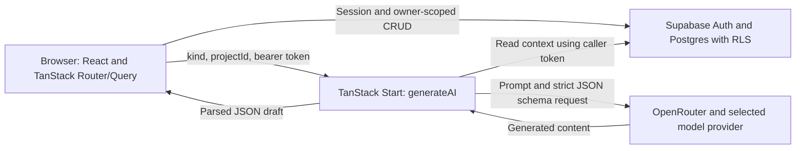

# First Ten: Product Spec and Developer Onboarding

First Ten helps a student founder turn early customer conversations into a clearer next move. This document explains the intended value, the behavior implemented in this repository, and the constraints that contributors must preserve.

Read this first, then [the roadmap's state and current iteration](FEATUREROADMAP_workplan.md). The [README](README.md) is the shorter introduction and setup guide. The roadmap decides what to investigate or build next; this spec does not authorize its candidate features.

**Documentation basis, 2026-10-17:** implementation checked against the source following `ce0f2fe`; product direction follows Iteration 4, introduced in `0848ab2`. Descriptions of deployment configuration are recorded operational history, not a new live-environment audit. The revised value proposition is a hypothesis; no completed participant interviews or product-outcome study is recorded in `research/` yet.

## 1. Product in one paragraph

First Ten is a mobile-first customer-discovery app for student founders with a live prototype or app and few or no recurring users. It provides editable interview questions, consent-led note taking, synthesis, experiments and outreach drafts across a three-stage ladder: **First 10**, **Next 50**, **Next 100**. The founder chooses whom to approach, has the conversations, reviews the drafts and decides what to do. The candidate promise is: **turn real customer conversations into a clearer next move—who to focus on, what to change, and what to try next.** Finding users who return is the longer-term aspiration; conversation counts and an accepted AI summary do not establish demand.

### 1.1 The user, trigger and job

The initial research focus is a student founder who has built something, recently tried to recruit users, and is unsure whether to change the product, change the audience or keep trying. Course and self-directed founders may need different kinds of support; do not combine their outcomes without recording that context.

| Role                                                   | Value to investigate                                                                                          | What remains unknown                                                                                                    |
| ------------------------------------------------------ | ------------------------------------------------------------------------------------------------------------- | ----------------------------------------------------------------------------------------------------------------------- |
| Founder, primary user                                  | Take a manageable external action, learn from a relevant person, and choose the next step with less guesswork | Whether access, time, skill, confidence or decision-making is the main blocker; whether the workflow earns repeated use |
| Instructor or program lead, possible reviewer/champion | Understand what a team heard, what changed and where feedback would help                                      | Whether reviewing this evidence improves their existing process; no instructor-facing product exists                    |
| Budget owner                                           | Fund an outcome that matters to a course or program                                                           | Who approves and pays, how purchasing works, and whether any purchase is justified                                      |

The functional job is choosing a useful next action. The possible emotional benefit is less uncertainty about reaching out or changing direction. The possible social benefit is explaining one's reasoning to teammates or reviewers. These benefits need observation, not just agreement with a pitch.

The working differentiation is continuity from conversation to follow-through. Compare it with a founder's actual combination of AI chat, documents, spreadsheets, course assignments and mentoring. Do not assume those alternatives lack memory, structure or analysis, or claim an uncontested market. [VP-007](FEATUREROADMAP_workplan.md) audits the inherited alternatives scan before those claims are reused.

### 1.2 The value loop and its current support

| Step                      | Intended useful outcome                                 | Implemented support                                            | Remaining gap                                                                                  |
| ------------------------- | ------------------------------------------------------- | -------------------------------------------------------------- | ---------------------------------------------------------------------------------------------- |
| Choose a relevant person  | Know why this person has experience of the problem      | Contact first name, relationship and reason to ask             | No verified prospect discovery or audience-fit check                                           |
| Ask about recent behavior | Understand a concrete situation and workaround          | Editable questions; one-question-per-screen interview session  | No question-quality checker or live coaching                                                   |
| Preserve observations     | Keep notes, exact words and uncertainty distinguishable | Question/note/quote answers and tags                           | No claim-level evidence links, persisted consent record or interview authenticity verification |
| Make a decision           | Explain what to change, retain, test or stop            | Editable synthesis, suggested changes and experiment fields    | No structured decision record, confidence model or counterevidence workflow                    |
| Follow through            | See what happened after the next action                 | Experiment results, manual contact pipeline and Stage 3 counts | No automatic usage tracking, follow-up reminders or repeated-loop measurement                  |

A useful result might be: “These two people described the same costly workaround; I will focus on their situation and test one change.” A useful result can also be: “The people I approached do not have this problem; I will change the audience or stop.” The app should not force a positive conclusion or a commitment just to count progress.

### 1.3 Product principles

Changes to these principles require a decision in the roadmap.

1. **AI drafts, the founder decides.** Questions, summaries and outreach are reviewable drafts. The app does not send outreach, publish posts or contact interviewees. Sending data to the AI provider is a separate operation described in §5.
2. **Ask about past behavior.** Interview guidance asks what happened, what people tried and what it cost. Avoid pitching and hypothetical willingness questions. The existing `would use` and `would pay` tags are a legacy mismatch; treat them as reported statements, not observed use or payment.
3. **Fit matters more than familiarity.** A friend can be a relevant participant; knowing the founder is not evidence of having the problem. Record the reason for speaking to them.
4. **Respect the participant.** Use first names or roles and obtain permission before taking notes. Do not enter sensitive personal information. Note-taking consent does not by itself establish permission for external AI processing or sharing quotes.
5. **Keep the next action small.** Use plain language, mobile layouts and a clear next step. Add complexity only when it helps a real decision.
6. **Evidence includes disagreement.** Preserve observations, interpretations and limits. Introductions, trials, repeat use and payments answer different questions; there is no implemented universal validation score.
7. **Make uncertainty visible.** The ladder is a scaffold, not proof of demand, guaranteed customer acquisition or certification that interviews happened.
8. **Carry reviewed learning forward.** Later stages build on the previous stage’s accepted learnings alongside the underlying interviews. Preserve that continuity when adding growth features; do not replace reviewed evidence with generic advice.

### 1.4 How value will be assessed

Iteration 4 tests the workflow with interviews, manual concepts and a three-founder pilot before selecting a new feature. These are proposed research measures, not metrics already instrumented in the app:

| Measure        | Proposed definition                                                                                                        |
| -------------- | -------------------------------------------------------------------------------------------------------------------------- |
| Activation     | First conversation with a relevant person within 7 days of pilot onboarding; distinguish onboarding from account signup    |
| Useful loop    | Within 14 days, an external action plus a specific decision tied to observations, counterevidence/unknowns and a next step |
| Repeat value   | A voluntary return or second loop, separated from course requirements and researcher prompting                             |
| Follow-through | Requested, agreed and completed actions recorded separately; distinguish trial, intro, repeat use and payment              |
| Reviewer value | A reviewer uses a de-identified record to make a concrete feedback decision                                                |

Record denominators, withdrawals and assistance. A facilitated paper exercise can demonstrate interest in a workflow without demonstrating that the app works independently. The pilot's 2-of-3 continuation rule is a planning threshold for another test, not market validation. The [roadmap](FEATUREROADMAP_workplan.md) owns the full protocol and hypothesis decisions.

## 2. User journey and screens

### 2.1 Route map

| Route        | Source                                                   | Implemented behavior                                                                                                                         |
| ------------ | -------------------------------------------------------- | -------------------------------------------------------------------------------------------------------------------------------------------- |
| `/`          | [index.tsx](src/routes/index.tsx)                        | Landing page; current live-copy source still presents the 10/50/100 ladder                                                                   |
| `/auth`      | [auth.tsx](src/routes/auth.tsx)                          | Email magic-link request with redirect to the current origin's `/auth`; an existing session sends the user to `/dashboard`                   |
| `/setup`     | [setup.tsx](src/routes/_authenticated/setup.tsx)         | Create or edit the single selected project: name, description, audience, problem and optional link                                           |
| `/dashboard` | [dashboard.tsx](src/routes/_authenticated/dashboard.tsx) | Next-step card, rung progress, pipeline and learnings/experiments timeline                                                                   |
| `/contacts`  | [contacts.tsx](src/routes/_authenticated/contacts.tsx)   | Stage-specific contacts, relationship/relevance prompts and status updates                                                                   |
| `/interview` | [interview.tsx](src/routes/_authenticated/interview.tsx) | Generate/edit/save questions; choose a pending Stage 1 contact and confirm permission; take notes one question at a time and save at wrap-up |
| `/learnings` | [learnings.tsx](src/routes/_authenticated/learnings.tsx) | Generate/edit/accept a Stage 1 synthesis; manage checklist and experiments; unlock the next stage                                            |
| `/outreach`  | [outreach.tsx](src/routes/_authenticated/outreach.tsx)   | Stage 2 channel/message/survey drafts and pipeline; Stage 3 channels, referral asks, onboarding questions and manual metrics                 |

The authenticated route [guard](src/routes/_authenticated/route.tsx) uses `auth.getUser()` and disables SSR for that branch. The main project screens use [RequireProject](src/components/RequireProject.tsx) to load the first project or redirect to setup. `/setup` is intentionally outside that project requirement and does not use `AppShell`. Interview preparation uses the shell; the conversation session has its own focused layout.

[AppShell](src/components/AppShell.tsx) supplies the header, sign-out action and bottom tabs: Ladder, People, Interview, Learnings and Outreach. It also exports `Card`, `Empty`, `DraftBadge` and `PrivacyNote`.

### 2.2 First-session behavior

1. Sign in and describe the project. `useProject()` selects the earliest project by `created_at`; there is no project switcher.
2. Add a Stage 1 contact with a first name, relationship and reason they might have the problem.
3. Generate the initial question list, edit it and save it. The prompt requests nine past-behavior questions ending with a referral question; the founder can add, remove or rewrite questions. The initial empty state currently offers AI generation, not an empty manual-list editor.
4. Select a pending Stage 1 contact and confirm permission to take notes. The checkbox enables **Begin**; it is local UI state and is not stored with the interview.
5. Capture notes and optional exact quotes. Use Back/Next to review; choose tags at wrap-up and save the interview. Notes remain in component state until that final save. Leaving or refreshing can lose an unfinished session; no autosave, offline queue or resume support is implemented.
6. Review patterns and decide what to do. The usual synthesis entry point appears after five completed interviews; an existing synthesis remains visible even if the current count falls below five. The synthesis is editable, can be saved without acceptance, and must be accepted for the Stage 1 checklist.
7. Log an experiment and later update its result. Before five interviews, use notes or a manual research template for reflection; do not imply that the app offers early AI synthesis through its normal UI.

### 2.3 Stage counters and unlocks

`projects.stage` represents the highest stage unlocked through the normal UI. [stageProgress](src/lib/data.ts) computes counters; [stages.ts](src/lib/stages.ts) builds the unlock checklist. The display targets and unlock conditions are different:

| Stage        | Display target and count                                                  | Requirements to unlock the following stage                                                                                                              |
| ------------ | ------------------------------------------------------------------------- | ------------------------------------------------------------------------------------------------------------------------------------------------------- |
| 1 — First 10 | Target 10; counts completed interview rows, not distinct qualified people | At least 5 completed interviews; accepted Stage 1 synthesis; at least 1 Stage 1 experiment; founder ticks best-fit-user and made/scheduled-change items |
| 2 — Next 50  | Target 50; Stage 2 contacts whose status is `tried`, `active` or `paying` | At least 10 such contacts; nonempty survey; at least 1 Stage 2 experiment; founder ticks the survey-review item                                         |
| 3 — Next 100 | Target 100; Stage 3 contacts with the same three statuses                 | No further stage                                                                                                                                        |

The founder clicks the unlock button when the checklist is satisfied. Automatic checklist entries come from loaded data; manual entries live in `projects.checklist`. These are UI rules, not server/database-enforced validation of research quality or stage eligibility. There is no implemented evidence override or commitment gate.

Contact status starts as `to_contact`; saving an interview changes its contact to `interviewed`. The later pipeline offers `contacted`, `replied`, `tried`, `active` and `paying`. These are manually reported statuses, not verified product analytics or transactions. A new Stage 2/3 contact can still begin with the default `to_contact`.

Stage 3 stores `signups`, `active` and `returning` in `projects.checklist.metrics` and calculates two ratios for display. These counts are separate from the stage contact counters, have no stored reporting period and are not automatically reconciled with them. The survey is editable text to copy elsewhere; there is no hosted response form or survey-response table.

### 2.4 Editing, regeneration and persistence

- Questions are saved as the project's current list. Completed interviews retain their question text in each answer.
- Synthesis edits update the current learning. Regeneration replaces its `data` and resets `accepted` to false; prior versions are not archived. Saving edits to an accepted synthesis keeps its accepted flag.
- Outreach bodies are editable and save on blur. Regeneration deletes that stage's existing outreach rows and inserts replacements; Stage 2 generation also replaces the survey. Preserve wanted drafts before regenerating.
- Experiment hypothesis/change/result are stored at the current stage; result updates save on blur. Logging an experiment satisfies the checklist even when its result is still empty.
- Multi-step writes are not transactions, and some mutation paths do not inspect every returned Supabase error. A success message is not a substitute for checking persisted state when debugging or running a pilot.

## 3. Architecture



The browser persists returned drafts using the same authenticated Supabase client. The AI server function does not write the generated result to the database.

| Responsibility          | Implementation and boundary                                                                                                                                                                                                             |
| ----------------------- | --------------------------------------------------------------------------------------------------------------------------------------------------------------------------------------------------------------------------------------- |
| Queries and refresh     | [data.ts](src/lib/data.ts): React Query hooks; `useRefresh()` invalidates named table/query prefixes                                                                                                                                    |
| Browser database access | [client.ts](src/integrations/supabase/client.ts): public Supabase configuration and the user's auth session; RLS applies                                                                                                                |
| Authenticated AI calls  | [auth-attacher.ts](src/integrations/supabase/auth-attacher.ts) attaches the bearer token; [auth-middleware.ts](src/integrations/supabase/auth-middleware.ts) verifies claims and creates a per-request Supabase client using that token |
| Global middleware       | [start.ts](src/start.ts) registers the auth attacher, server error handling and CSRF middleware for server functions                                                                                                                    |
| AI orchestration        | [ai.functions.ts](src/lib/ai.functions.ts): the single `generateAI` server function, prompt/schema selection, context assembly and OpenRouter call                                                                                      |
| Admin access            | [client.server.ts](src/integrations/supabase/client.server.ts): service-role client; no current app call site uses it; keep server-only                                                                                                 |
| Build and SSR           | [vite.config.ts](vite.config.ts) uses the Lovable wrapper; [server.ts](src/server.ts) wraps SSR errors. Set `NITRO_PRESET=vercel` for the Vercel build                                                                                  |
| UI system               | [styles.css](src/styles.css): Tailwind tokens, Bricolage Grotesque display font and Figtree body font; generated shadcn/Radix primitives in `src/components/ui/`                                                                        |

The Lovable wrapper already installs TanStack, React, Tailwind, path aliases and Nitro plugins. Do not add duplicates while it remains. Error-reporting/preview-auth scaffold files still exist and some are connected to the runtime; evaluate their behavior and dependencies before cleanup. Preserve the Git-history protections in [AGENTS.md](AGENTS.md).

## 4. Data model

The six-table schema is defined in [the initial Supabase migration](supabase/migrations/20261017000000_init.sql); generated shapes are in [types.ts](src/integrations/supabase/types.ts). Every table has `id`, `user_id` (default `auth.uid()`) and `created_at`. The five child tables also carry `project_id`.

| Table         | Important columns                                                               | Relationship and behavior                                                                                                 |
| ------------- | ------------------------------------------------------------------------------- | ------------------------------------------------------------------------------------------------------------------------- |
| `projects`    | name, description, audience, problem, link, stage, questions, survey, checklist | Earliest row is selected. One project per user is an app convention, not a uniqueness constraint                          |
| `contacts`    | project_id, first_name, relation, why, stage, source, status                    | Project deletion cascades; `source` begins as `warm` or supplied relationship text                                        |
| `interviews`  | project_id, nullable contact_id, answers, tags, completed                       | `answers` is `{q, note, quote}[]`; deleting a contact sets `contact_id` to null and retains the interview                 |
| `learnings`   | project_id, stage, kind, title, body, data, accepted                            | Current synthesis uses `kind=synthesis`, stage 1 and structured data from §5; `note` also exists as a schema kind/default |
| `experiments` | project_id, stage, hypothesis, change, result                                   | Current fields are free text; result may be supplied later                                                                |
| `outreach`    | project_id, stage, kind, title, body                                            | Kinds used by the UI: channel, draft, referral, onboarding; no version/archive columns                                    |

### Ownership and schema limits

The migration grants CRUD to `authenticated`, enables RLS and applies `USING` and `WITH CHECK` conditions requiring `auth.uid() = user_id`. Anonymous users have no policy granting access to application rows. The service role has privileged access and must remain server-only.

RLS checks the owner of each row. Foreign keys enforce that referenced projects/contacts exist, but do not independently check that a child, its project and its contact belong to the same owner or project. Do not describe this as comprehensive relational ownership enforcement. Revisit constraints and policy tests before expanding relationships, sharing or cohort access.

Stages, statuses, kinds and JSON shapes are application conventions rather than enum/check constraints in this migration. There is no persisted consent field, source-verification field, AI model/prompt-version metadata, event log, commitment table, instructor-interest table or usage ledger. Proposed schemas in old roadmap tasks are not implemented tables.

Add migrations rather than editing an applied migration. After a schema change, regenerate types with `supabase gen types typescript --linked` and review the resulting diff. Do not reset a linked production database as a normal development step.

## 5. The AI layer

All AI calls go through `generateAI` in [ai.functions.ts](src/lib/ai.functions.ts). Keep prompts and the OpenRouter key server-side.

### 5.1 Kinds, outputs and context

| Kind        | Output shape                                                                | Prompt intent                                                 | Context included in the provider request                                                                                                                    |
| ----------- | --------------------------------------------------------------------------- | ------------------------------------------------------------- | ----------------------------------------------------------------------------------------------------------------------------------------------------------- |
| `questions` | `questions: string[]`                                                       | Nine past-behavior questions, ending with a referral question | Project name, description, audience and problem                                                                                                             |
| `synthesis` | problems, objections, best_fit, quotes arrays; changes as title/body pairs  | Summarize interviews and suggest three changes                | Project fields plus completed interview answers/tags, truncated to 14,000 serialized characters                                                             |
| `stage2`    | channels and drafts as title/body pairs; survey array                       | Places to reach people, outreach drafts and survey questions  | Project fields, completed answers/tags, accepted learning title/body/data/kind (6,000 characters), and contact relation/why/source/stage (3,000 characters) |
| `stage3`    | channels as title/body pairs; referral_asks and onboarding_questions arrays | Further outreach and onboarding prompts                       | Project fields, completed answers/tags and accepted learnings                                                                                               |

The handler reads interviews, accepted learnings and contacts for every kind, but includes only the fields shown above in the prompt. It does not include the project's link, contact `first_name`, contact ids or interview ids in those serialized context selections. Free text can still contain identifying details; omission of a structured name field is not automatic anonymization. These calls do not browse the web, verify communities or fetch the project's URL.

Context is sliced by characters without a deterministic query order or a separate source-selection policy. Slicing can omit evidence or cut serialized JSON mid-record. The current synthesis cannot provide reliable record-id citations because interview ids are not supplied to it.

### 5.2 Provider contract and limits

Requests use OpenRouter chat completions, `response_format.type=json_schema`, `strict:true` and `provider.require_parameters:true`. `SCHEMAS` defines required properties and disallows additional object properties. Array counts and interview-quality rules are expressed in prompts, not array-length constraints.

The application parses the returned content as JSON, with a fallback that extracts an object-shaped substring. It does not independently validate the returned object against the schema, verify copied quotes, or check semantic grounding. The input validator is also a typed pass-through rather than runtime validation of `kind` and `projectId`. Provider structured-output settings do not establish the truth of a claim.

`OPENROUTER_MODEL` selects the model, otherwise the code defaults to `anthropic/claude-sonnet-4.5`. Omit this variable or set a nonempty value: the code uses `??`, so a present empty string does not select the default. The `OPENROUTER_API_KEY` never belongs in a browser-exposed variable. `APP_URL`, when set, supplies the request's `HTTP-Referer` header.

### 5.3 Reliability and errors

- At most three fetch attempts. HTTP 429/5xx responses retry with 800 ms and 1,600 ms waits; thrown network errors retry immediately.
- One `AbortSignal.timeout(60_000)` is shared across those attempts. This is not a fresh 60-second allowance for each retry.
- Missing configuration, empty/malformed content and HTTP 401/402/429 have explanatory errors. Other HTTP failures use a generic retry message; repeated fetch exceptions are reported as a timeout even if their cause differs.
- No streaming, fallback-model list, per-user rate/spend cap, usage/cost persistence, prompt registry or eval harness is implemented.

A returned draft is not yet a saved draft: the caller must persist it and handle the write result. Some existing paths need better error checks; do not copy their omissions into new work.

### 5.4 Data handling and future AI changes

Supabase stores application records. On generation, selected project and interview content is sent through OpenRouter to the selected model provider. The app does not implement automatic redaction, separate provider-processing consent, a retention policy UI or account export/delete. Its note-taking checkbox is not an audit trail or a provider-consent mechanism. Avoid sensitive notes, and follow the research protocol's processing and sharing choices before using participant material.

Before adding or changing AI behavior, follow the roadmap's prompt-versioning, eval and privacy prerequisites. Extend the existing `Kind` switch, schema, prompt and context rules rather than adding a second gateway. Include runtime/schema checks and failure/grounding fixtures appropriate to the change. Keep third-party text as untrusted data and keep new AI functionality reviewable by the founder.

## 6. Conventions and verification

- Use strict TypeScript and the `@/` alias for `src/`. TanStack routes use `createFileRoute`; do not hand-edit [routeTree.gen.ts](src/routeTree.gen.ts).
- Signed-in project pages belong under `src/routes/_authenticated/` and normally use `RequireProject` plus `AppShell`; preserve the setup/session exceptions in §2.
- Use the session-scoped Supabase client for owner-scoped CRUD. Inspect errors before reporting success, and call `useRefresh()` with affected query/table names after a successful mutation.
- Preserve one selected project, `user_id` ownership, `project_id` on child rows, `projects.stage` for unlocks and `projects.checklist` for small manual state unless a migration and decision explicitly change them.
- UI copy is plain, friendly, second person and sentence case. Use mobile layouts, large primary targets and safe-area padding. Do not promise evidence quality that the code does not enforce.
- Collect first names or roles, not interviewee emails, phone numbers or last names. The founder's sign-in email is handled separately by Supabase Auth.
- Only public configuration goes in `VITE_*`. Never expose the OpenRouter or service-role key. Do not commit `.env`, credentials, participant contact details or sensitive research material.
- Generated shadcn primitives should be edited sparingly. Do not duplicate plugins already provided by the Lovable wrapper.
- Commit small changes with the roadmap task id; preserve published history. Never force-push or rewrite commits already synced to Lovable.

[Vitest configuration](vitest.config.ts) discovers tests throughout `src/`. Existing coverage includes [stage counters](src/lib/data.test.ts), [unlock logic](src/lib/stages.test.ts), [routing](src/test/app-routing.test.tsx), and [page rendering](src/test/pages.test.tsx), using [fake Supabase](src/test/fake-supabase.ts) and [render helpers](src/test/render-page.tsx). These mocks do not prove production RLS, real auth, provider correctness or deploy readiness.

The [CI workflow](.github/workflows/ci.yml) uses Bun 1.3.5 and runs lint, typecheck, tests and a Vercel-preset build on pushes to `main` and pull requests. Consult the roadmap's F-007 Notes for recorded verification; the existence of a workflow is not a green result. New routes need meaningful routing/render coverage; changed pure helpers need appropriate unit coverage. AI behavior changes require evals once the prerequisite harness exists. Research/documentation tasks use source and artifact checks rather than silently implementing deferred features.

## 7. Local dev quickstart

Use Node **22.12.0 or newer** with npm available to invoke the pinned Bun version. Bun 1.3.5 matches CI and the committed `bun.lock`; a global Bun install is optional.

```sh
npx bun@1.3.5 install --frozen-lockfile
cp .env.example .env
# Fill both server and VITE_ Supabase URL/public-key pairs, plus OPENROUTER_API_KEY.
# Set OPENROUTER_MODEL to a nonempty model id, or remove that line for the default.
npx bun@1.3.5 run dev
```

Use the dev-server URL printed by Vite; port selection comes from the wrapper. Configure the corresponding origin and `/auth` redirect in Supabase before testing magic links. `.env` is ignored by Git. [README environment guidance](README.md#environment-variables) distinguishes required runtime values from template-only or optional fields.

Run the repository's verification scripts when changing product code:

```sh
npx bun@1.3.5 run lint
npx bun@1.3.5 run typecheck
npx bun@1.3.5 run test
NITRO_PRESET=vercel npx bun@1.3.5 run build
```

If `.vercel/output` already exists, use `npx bun@1.3.5 run lint --ignore-pattern '.vercel/**'` for the local lint check. The current ESLint ignore list does not exclude generated Vercel output; CI avoids this by linting before building.

The same scripts can be invoked with `npm run <script>` after dependencies are installed; preserve the committed package-manager lockfile. For schema work, link a deliberate development Supabase project, inspect pending migrations, and use `supabase db push`. A linked database is a real remote target; `db reset --linked` is destructive and is not part of this quickstart.

## 8. Operations

### Recorded deployment setup

| Component  | Recorded configuration                                                                                                               |
| ---------- | ------------------------------------------------------------------------------------------------------------------------------------ |
| Repository | [ianroy/first-10](https://github.com/ianroy/first-10), private; connected history must remain intact                                 |
| Hosting    | Vercel project `first-10`, team `ianroy-1382s-projects`; [production alias](https://first-10-three.vercel.app)                       |
| Database   | Supabase project `first-10`, ref `hdwnnuvqqkkpontcdbwa`, recorded region `us-east-1`                                                 |
| Delivery   | Roadmap F-009 records Vercel Git connection and deploys from `main`; preview environment configuration remains unverified/incomplete |
| Auth       | F-010 records owner-confirmed production magic-link sign-in and AI generation on 2026-10-17                                          |

Do not repeat the old claim that Vercel is not Git-connected. Also do not infer that a PR preview, CI run or production deployment works from this recorded configuration alone.

### Configuration and release checks

- `SUPABASE_URL` and `SUPABASE_PUBLISHABLE_KEY` serve the server middleware; `VITE_SUPABASE_URL` and `VITE_SUPABASE_PUBLISHABLE_KEY` supply browser build-time configuration. Set both pairs for the same intended backend.
- `OPENROUTER_API_KEY` is server-only. `SUPABASE_SERVICE_ROLE_KEY` belongs only to the unused privileged client, not the normal AI/CRUD path. Project-ref variables remain in the template but are not read by the current application code.
- Set `NITRO_PRESET=vercel` for Vercel builds. A public variable added after building will not repair the already-generated browser bundle; rebuild with the correct values.
- A previous deployment missed the public Supabase key and failed at runtime. The incident record notes the Vercel CLI needed `--type config` for that public key. Verify configuration using the current deployment tooling; never use that public classification for a secret key.
- Confirm Supabase Site URL and allowed redirect URLs for each intended environment, including `/auth`. Production values do not automatically configure preview or local auth.
- After an authorized deployment, check `/`, `/auth`, magic-link return, project load and one AI generation with non-sensitive data. Automated post-deploy smoke coverage is still X-001 work. Check actual CI/deploy results separately.

A push to the recorded connected branch can trigger Vercel and Lovable synchronization. Push-to-deploy does not by itself apply Supabase migrations: the current CI workflow contains no migration step. Coordinate database changes explicitly, keep compatible application releases, and use new revert/fix commits rather than rewriting published history.

## 9. Known gaps and research priorities

1. **Single project and no instructor product.** The app selects the earliest project; there is no project switcher, cohort view, reviewer access, billing or validated buyer. Test founder value and the buying path separately.
2. **Counts are limited evidence.** Interview totals, self-ticked checklist items and manual contact statuses drive progress. Distinct qualified people, commitments and independently measured behavior are not established by these counters.
3. **Interview quality is unchecked.** Prompts request past behavior, but edited questions and notes are not coached or linted. The existing hypothetical tags need care when interpreting evidence.
4. **Regeneration can discard work.** Outreach replacement is destructive; synthesis overwrites the current version. Archive/restore remains unimplemented.
5. **AI controls are incomplete.** No usage ledger/cap, versioned prompt registry, eval harness or runtime schema/quote validation. Timeout/retry behavior exists but does not complete all of F-002.
6. **Interview capture is fragile.** Notes save only at wrap-up; no offline/PWA, autosave or session recovery.
7. **Channel suggestions are not verified research.** AI suggestions have no browsing, community-rule lookup or live source checking. The old direct Reddit audit is cancelled; the supplied title-level brief is inspiration only.
8. **Scaffold and delivery work remains.** The Lovable wrapper/runtime support files remain; F-007's recorded checks, preview setup and X-001 smoke coverage must be verified on their own terms.
9. **The next-decision promise is not validated.** No completed research interviews, pilot outcome dataset or synthesis is recorded yet. A manual decision record is a planned experiment, not a shipped feature.
10. **Privacy and ownership need further work.** Consent is not persisted; export/delete, provider-processing choices and sharing controls are absent. Cross-row ownership consistency is not enforced by the current foreign keys/policies.
11. **Measurement is manual.** No product event log or automatic activation/retention tracking exists. Stage 3 counts are entered by the founder and have no historical period series.
12. **Writes and validation need hardening.** Some multi-step writes can partially succeed; UI stage thresholds and TypeScript shapes are not runtime or database invariants.

Iteration 4 investigates the user, alternatives, action blockers, useful decisions and reviewer needs. Evidence-linked synthesis, coaching, commitments, challenge responses, Evidence Packs and first-ask help remain candidates. Neither the R0 research gate nor the R1 foundation gate is recorded as passed. Select the smallest next investment after the evidence review; do not execute older feature schedules simply because their definitions remain in the roadmap.
