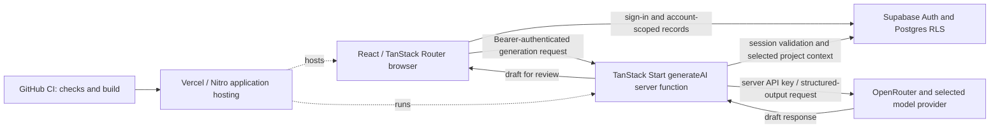

# First Ten system overview

Source basis: `84003f6` plus the VP-007 claim audit, checked 2026-10-18. This describes implemented request paths. Role, budget and collaboration extensions remain governed by their roadmap tasks; the diagram alone does not implement or verify them.

## Public explanation

The browser presents a workspace for interviews, learning and next actions. Supabase provides sign-in and saved project data. When a signed-in user asks for AI assistance, one server function selects context from that user's project and requests a structured draft through OpenRouter. The user reviews the result. The provider key stays server-side. Vercel builds and hosts the app.

[StackDiagram.tsx](../../src/components/marketing/StackDiagram.tsx) is the accessible public component. It has a text equivalent; its icons are decorative. [Download the schematic](../../public/diagrams/current-stack.svg).

## Current request paths

The graph describes logical relationships rather than packet direction or a claim that every application write goes through a server function. Current application record operations also use the authenticated browser Supabase client.

## Source map and boundaries

| Responsibility                 | Source                                                                                                   | Current limit                                                                                                             |
| ------------------------------ | -------------------------------------------------------------------------------------------------------- | ------------------------------------------------------------------------------------------------------------------------- |
| Root/route rendering           | [root](../../src/routes/__root.tsx), [Vite config](../../vite.config.ts)                                 | TanStack Start configuration is wrapped by the existing Lovable package                                                   |
| Browser authentication/storage | [Supabase client](../../src/integrations/supabase/client.ts)                                             | Public URL/key are browser configuration; secret keys must never use VITE_ names                                          |
| Generation authentication      | [middleware](../../src/integrations/supabase/auth-middleware.ts)                                         | Verifies supplied bearer token and creates authenticated Supabase context                                                 |
| All AI requests                | [generateAI](../../src/lib/ai.functions.ts)                                                              | Four current kinds with runtime input/output validation and bounded retries; source grounding and metering remain planned |
| Application records            | [data.ts](../../src/lib/data.ts), [initial migration](../../supabase/migrations/20261017000000_init.sql) | Current owner-only rows and implicit first project; relationship consistency hardening remains planned                    |
| Delivery                       | [CI](../../.github/workflows/ci.yml), [server entry](../../src/server.ts)                                | A green build is not proof of live role policies or model quality                                                         |

Current interview note consent is a session checkbox, not stored provider-processing or sharing permission. Free text can identify people even when contact names are omitted from AI selection. Do not describe current data isolation as an independently audited security guarantee.

## Planned extensions

The canonical [task registry](../roadmap/tasks.json) schedules the access/API contracts and future permission boundaries. Contract files are prerequisites, not deployed services. Planned extensions include explicit project selection, persisted drafts/choices, a protected usage ledger, teacher-reviewed submissions, operational aggregates, shared design revisions and conditional realtime. They must not be drawn as live backend capabilities before their implementation/release checks pass.

Public fictional demonstrations are designed to work without provider calls or production writes. WEB-002 supplies that implementation; this architecture task does not itself establish it exists.
